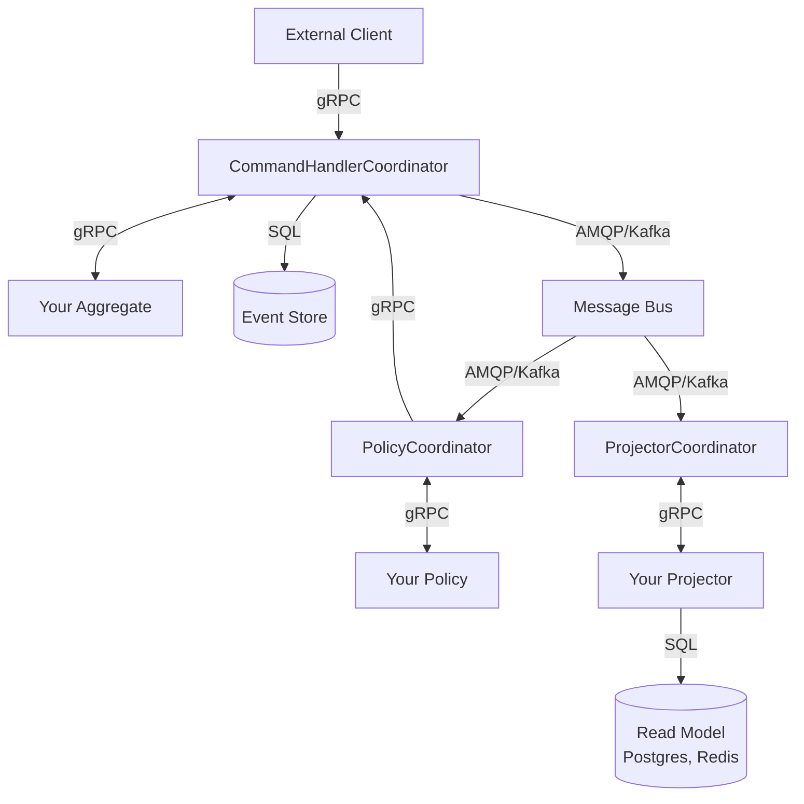
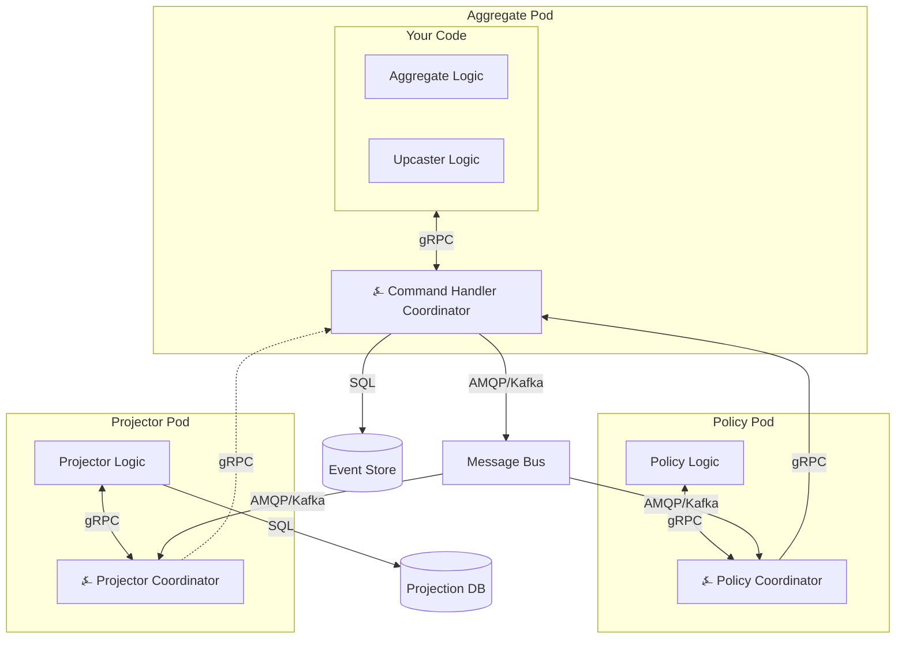

This document covers ⍼ Angzarr's core architectural concepts: event sourcing data model, coordinator pattern, deployment model, and synchronization modes.

---

## Event Sourcing Data Model

⍼ Angzarr stores aggregate history as an **EventBook**—the complete event stream for a single aggregate root:

| Component | Purpose |
|-----------|---------|
| **Cover** | Stream identity only: domain, root, and edition (unset for main) |
| **Snapshot** | Point-in-time state for replay optimization |
| **EventPages** | Ordered sequence of events: each a domain `event`, or a framework `meta_event` (an edition's fork), with its sequence and `EventMeta` (causation, correlation, `recorded_at`, rules version) |

```protobuf file=proto/io/angzarr/v1/types.proto region=cover
```

```protobuf file=proto/io/angzarr/v1/types.proto region=event_page
```

```protobuf file=proto/io/angzarr/v1/types.proto region=aggregate_snapshot
```

```protobuf file=proto/io/angzarr/v1/types.proto region=event_book
```

What each field means: `docs/design/identity-and-streams.md` §5, and `docs/design/snapshots.md` for the snapshot.

Commands use a similar envelope, but a **CommandBook** carries exactly one command (one **CommandPage**) for a single aggregate: deduplication, the expected-sequence check and the outcome are per command, so there is no wire batching.

---

## Coordinator Pattern

⍼ Angzarr uses coordinators to route messages between external clients and your business logic. This separation keeps domain code focused while the framework handles:

- Event persistence and retrieval
- Optimistic concurrency: a per-stream append at the loaded head, lost races re-run on current state
- Snapshot management
- Event upcasting (schema evolution on read)
- Synchronous vs. asynchronous processing

### Component Types

| Coordinator | Routes | Purpose |
|-------------|--------|---------|
| **CommandHandlerCoordinator** | Commands → Aggregates | Command handling, event persistence |
| **ProjectorCoordinator** | Events → Projectors | Read model updates, side effects |
| **PolicyCoordinator** | Events → Policies | Cross-domain command orchestration |
| **CommandHandlerCoordinator**, for a PM's domain | Commands and facts → Process managers | Stateful multi-domain workflows: a PM is a domain, fed by policies |



---

## Sidecar Deployment

⍼ Angzarr runs as a sidecar container alongside your business logic. Each pod contains your code and the appropriate coordinator, communicating over localhost gRPC.



### Benefits

- **Minimal attack surface**: ~8MB distroless container, no shell, no package manager
- **No network exposure**: Sidecar communicates over localhost only
- **Horizontal scaling**: Follows your service scaling—no separate capacity planning
- **Local gRPC**: Eliminates network latency between logic and framework

---

## Synchronization Modes

⍼ Angzarr provides mechanisms for controlling [sync vs async communication](https://eda-visuals.boyney.io/visuals/sync-vs-async) — when results return to callers.

### Command modes

How much of a command's processing the caller waits for is a call-level choice, never part of the command: one RPC per mode.

| RPC | Mode | Projectors | Policies | Use Case |
|-----|------|------------|----------|----------|
| `HandleAsync` | ASYNC | Async | Async | Fire-and-forget: validated and enqueued, nothing about the decision comes back |
| `Handle` | DECISION | Async | Async | Accept or reject synchronously; returns the persisted events |
| `HandleSync` | SIMPLE | The named ones, sync | Async | Read-after-write: also waits for the projectors the call names (`HandleSyncRequest.projectors`, required) |

No mode waits for reactions. Policies always run asynchronously, after the command's events are persisted, and the commands they send are separate commands with their own outcomes. Every mode publishes the persisted events downstream: there is no mode that writes silently. (Synchronous cascades were removed, decision 2.1: they coupled aggregates' availability and hid partial failure.)

### Event Streaming

For observing events as they happen rather than waiting:

```protobuf file=proto/io/angzarr/transport/distributed/v1/stream.proto region=event_stream_service
```

Events are correlated via each event's `EventMeta.correlation_id`, allowing clients to track causally-related events across aggregate boundaries: a subscription to one stream or to one correlation catches up from its resume point, then goes live, ordered per stream only (`docs/design/queries-and-subscriptions.md` §5 and §6).

---

## Pluggable Infrastructure

⍼ Angzarr abstracts storage and messaging behind adapter interfaces.

### Event Store Backends

| Backend | Status | Use Case |
|---------|--------|----------|
| SQLite | Tested | Local development, testing |
| PostgreSQL | Tested | Production |
| Redis | Tested | High-throughput scenarios |
| Bigtable | Tested | GCP deployments, petabyte scale |
| DynamoDB | Tested | AWS deployments, serverless |
| immudb | Implemented | Immutable audit requirements |

### Message Bus Backends

⍼ Angzarr uses [publish/subscribe messaging](https://eda-visuals.boyney.io/visuals/publish-subscribe) to distribute events to policies and projectors.

| Backend | Status | Use Case |
|---------|--------|----------|
| RabbitMQ/AMQP | Tested | Production |
| Kafka | Implemented | High-throughput streaming |
| GCP Pub/Sub | Implemented | GCP deployments |
| AWS SNS/SQS | Implemented | AWS deployments |

Configuration is declarative:

```yaml
# Production
storage:
  type: postgres
  connection_string: ${DATABASE_URL}

bus:
  type: amqp
  url: ${RABBITMQ_URL}

# Local development
storage:
  type: sqlite
  path: ./data/events.db

bus:
  type: channel
```

---

## Observability

Every command, policy, and projector execution is traced and metered at the coordinator level—your code requires zero observability boilerplate.

| Pipeline | Traced Spans | Metrics |
|----------|-------------|---------|
| Aggregate | `aggregate.handle`, `aggregate.execute` | `angzarr.command.duration` |
| Policy | `policy.orchestrate`, `orchestration.execute` | `angzarr.policy.duration` |
| Process Manager | `pm.orchestrate` | `angzarr.pm.duration` |
| Projector | `projector.handle` | `angzarr.projector.duration` |

Every span carries the `correlation_id`, so distributed traces follow commands through aggregate execution, policy fan-out, and downstream projections without manual context propagation.

When built with `--features otel`, the sidecar exports traces, metrics, and logs via OTLP to any compatible backend (Grafana, Datadog, AWS X-Ray, GCP Cloud Trace).

See [Observability](/operations/observability) for full details.

---

## Further Reading

For visual explanations of event-driven architecture concepts (events, messaging patterns, event sourcing, choreography vs orchestration, schema management):

- **[EDA Visuals](https://eda-visuals.boyney.io/)** by [@boyney123](https://twitter.com/boyney123) — Bite-sized diagrams explaining EDA concepts ([PDF download](https://eda-visuals.boyney.io/visuals/eda-visuals.pdf))

---

## Next Steps

- **[Components](/components/aggregate)** — Aggregate, policy, projector, process manager deep dives
- **[Getting Started](./getting-started)** — Set up your first aggregate
- **[Patterns](/reference/patterns)** — Advanced usage patterns
