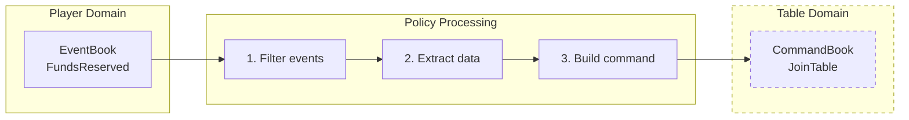

import { Tabs, TabItem } from '@astrojs/starlight/components';


A **policy** is a stateless [message translator](https://eda-visuals.boyney.io/visuals/message-translator-pattern) that bridges [bounded contexts](https://eda-visuals.boyney.io/visuals/messages-between-bounded-context). When an event occurs in one domain, a policy reacts by issuing commands to another domain.

Policies are the bridge between domains. Each domain has its own aggregate, but aggregates don't communicate directly. Instead, policies listen to events from one domain and build commands for another.

---

## One Source, One Destination

A policy translates between **exactly two domains**: events of its one source domain (its `input_domain`) into commands for its one destination domain (its `output_domain`). There is one policy per (source, destination) pair: every reaction from one domain's events to another domain's commands is part of that pair's single policy.

The destination may be an aggregate's domain or a [process manager](/components/process-manager)'s: a process manager is a domain, so a policy's commands reach it like any other domain's. Anything that needs several destinations, or state, is a process manager.

The coordinator enforces the shape when the component registers: a policy with other than exactly one input, or with no output domain, is refused (`COORDINATOR_REASON_POLICY_INPUT_COUNT`, `COORDINATOR_REASON_POLICY_NO_OUTPUT_DOMAIN`).

---

## Policy Pattern

Every policy follows this pattern:

1. **Receive** an EventBook from its source domain
2. **Filter** for the events it reacts to
3. **Extract** the data needed to build commands
4. **Return** commands for its destination domain, per triggering event



*The dashed domain represents the policy's one destination domain.*

The business code checks nothing and stamps nothing. The policy's coordinator checks every command it returns (destination, edition, root, correlation, no `Handling`, no identity of its own, a Command and never a Fact) and stamps its identity. Any failed check is a policy bug: the whole answer is refused `INTERNAL`, nothing is delivered, and the trigger is dead-lettered and alerted (`PolicyResponse` in `io/angzarr/v1/policy.proto`; the keys are listed in [Error Recovery](/operations/error-recovery)).

---

## Example: Table to Hand

When a table starts a hand, issue a DealCards command to the hand domain. Handler methods are registered by decorator / attribute / macro in the client library.

:::note[Example code predates the rename]
The example repositories still name this component a saga; they follow the contract's rename when they are reworked.
:::

<Tabs>
<TabItem label="Python">

```python file=vendor/examples/python/table/saga-hand/main.py region=saga
```

</TabItem>
</Tabs>

---

## Several Commands From One Event

When one event should trigger commands to **several roots** of the destination domain, return several `CommandBook` entries, one per target root. This is the [splitter pattern](https://eda-visuals.boyney.io/visuals/splitter-pattern).

**Example:** When a table settles, distribute payouts to several players:

```python file=vendor/examples/python/table/saga-hand/splitter_example.py region=saga_splitter
```

Each `CommandBook` targets a different root. The framework delivers them independently: if one is refused, the others may still succeed, and each refusal comes back to the policy's source as its own refusal fact (below).

---

## Refusals

When a target **refuses** one of a policy's commands, the target records nothing and may return a typed refusal object of its own domain (one of the command's `refuses` types). The refusal comes back to the policy, and the policy's coordinator builds one **refusal fact** for the exact stream of the triggering event; its id is the refused command's id.

- **Pass-through** (the default): the coordinator builds the standard `CommandRefused { command, refusal, trigger }`, the typed refusal object packed, and the source domain handles it in its `on_refused_<Command>(refusal, state)`, unpacking the foreign object.
- **Translate** (selected by the `angzarr` CLI per policy or per command, at code generation): the policy's callback reads `Refusal { event, command, response }` and returns a fact of the source domain, so a source that does not want to unpack a foreign object, or import foreign protos, gets a domestic fact.

The refusal fact is unrefusable, and it is the only fact a policy delivers: a policy's business code emits Commands only. The source decides what the refusal means and records its own events. There is no compensation side channel: the refusal is an ordinary fact in the source's own stream.

A refusal with no path (a pass-through `CommandRefused` whose command type the source has no handler for) is answered `ROUTER_REASON_NO_REFUSAL_HANDLER`, dead-lettered and alerted. See [Error Recovery](/operations/error-recovery#policy-refusals).

---

## Identity and Sequences

**Policies do not set ids or sequences.** The policy's coordinator stamps each command's identity:

```text title="reaction command identity"
causation_id   — the triggering event (its EventRef)
command_id     — UUIDv5 of (trigger, the policy's registered name,
                 the command's index in the reaction's output)
correlation_id — the trigger's, unchanged
```

A redelivered trigger therefore yields the same command ids, and the destination deduplicates them.

A reaction command carries no `Handling` at all: the destination always stamps its head before business code, so no sequence check or conflict resolution applies (`Handling` in `io/angzarr/v1/types.proto`). The destination's own command handler is the business guard: if the command no longer makes sense for the current state, it refuses it, and the refusal comes back as above.

Policies never load target state or sequences: the coordinator invokes a policy with the triggering events only.

---

## Transactional Guarantees

CQRS/ES architectures **cannot provide distributed ACID transactions**. Instead:

1. **Design for success**: a policy's commands should not be refused under normal operation
2. **Handle refusals**: the source handles the refusal fact for the rare refused command
3. **Eventual consistency**: cross-domain operations settle over time

A policy's commands, and its refusal facts, go through a transactional outbox stored with the policy's position, so a crash re-sends the recorded commands with their original ids rather than re-running the policy.

**If a policy's commands are frequently refused, reconsider your domain boundaries.**

---

## Further Reading

- [Message Translator Pattern](https://eda-visuals.boyney.io/visuals/message-translator-pattern) — The pattern policies implement
- [Messages between Bounded Context](https://eda-visuals.boyney.io/visuals/messages-between-bounded-context) — Cross-domain communication
- [Choreography vs Orchestration](https://eda-visuals.boyney.io/visuals/choreography-vs-orchestration) — Policies use choreography; process managers use orchestration

---

## Next Steps

- **[Commands vs Facts](/features/facts)** — Facts, and the one fact a policy delivers
- **[Projectors](/components/projector)** — Building read models
- **[Process Managers](/components/process-manager)** — Stateful multi-domain coordination
- **[Error Recovery](/operations/error-recovery)** — DLQ, retry, and refusal details
