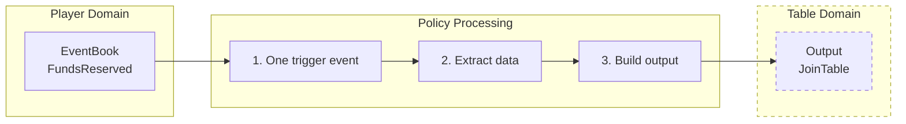

import { Tabs, TabItem } from '@astrojs/starlight/components';


A **policy** is a stateless [message translator](https://eda-visuals.boyney.io/visuals/message-translator-pattern) that bridges [bounded contexts](https://eda-visuals.boyney.io/visuals/messages-between-bounded-context). When an event occurs in one domain, a policy reacts by issuing commands to another domain.

Policies are the bridge between domains. Each domain has its own aggregate, but aggregates don't communicate directly. Instead, policies listen to events from one domain and build commands for another.

---

## One Source, One Destination

A policy translates between **exactly two domains**: events of its one source domain into commands and facts for its one destination domain (its `output_domain`). Its source is never declared: it is derived from the events it names (`PolicyDescriptor.input_domain`). There is one policy per (source, destination) pair: every reaction from one domain's events to another domain's inputs is part of that pair's single policy. A policy emits what its destination declares: a command for a type declared `(command)`, a fact for one declared `(fact)` (decision 14.69).

The destination may be an aggregate's domain or a [process manager](/components/process-manager)'s: a process manager is a domain, so a policy's commands reach it like any other domain's. Anything that needs several destinations, or state, is a process manager.

The shape is enforced twice. Generation fails for a policy whose events come from more than one domain, or that declares no output domain. The coordinator checks the descriptor when the component registers: one with no source or no output domain is a readiness refusal (`ANGZARR_REASON_NO_INPUT_DOMAIN`, `ANGZARR_REASON_POLICY_NO_OUTPUT_DOMAIN`).

---

## Policy Pattern

Every policy follows this pattern:

1. **Receive** one trigger event of its source domain (`React`, one call per event)
2. **Extract** the data needed for the destination's inputs
3. **Return** outputs: each a destination root and a payload, in the arm its destination declares



*The dashed domain represents the policy's one destination domain.*

The business code checks nothing and stamps nothing. An output (`io.angzarr.handler.v1.Output`) is a destination root and a payload, nothing else, so the coordinator addresses and stamps every one alike: the destination domain, the trigger's edition, the derived `command_id`, the trigger's correlation, the trigger as causation, and a fact's origin. It still checks what a type cannot hold: a root unset or not 16 bytes, an output to the trigger's own stream, a destination it cannot route, a chain too deep. Any failed check is a policy bug: the whole answer is refused `INTERNAL`, nothing is delivered, and the trigger is dead-lettered and alerted (`docs/design/policies.md` §2 and §6; the keys are listed in [Error Recovery](/operations/error-recovery)).

---

## Example: Table to Hand

When a table starts a hand, issue a DealCards command to the hand domain. Handler methods are registered by decorator / attribute / macro in the client library.

:::note[Example code predates the rename]
The example repositories still name this component a saga; they follow the contract's rename when they are reworked.
:::

<Tabs>
<TabItem label="Python">

```python file=vendor/examples/python/table/saga-hand/main.py region=saga
```

</TabItem>
</Tabs>

---

## Several Commands From One Event

When one event should trigger commands to **several roots** of the destination domain, return several outputs, one per target root. This is the [splitter pattern](https://eda-visuals.boyney.io/visuals/splitter-pattern).

**Example:** When a table settles, distribute payouts to several players:

```python file=vendor/examples/python/table/saga-hand/splitter_example.py region=saga_splitter
```

Each output targets a different root. The framework delivers them independently: if one is refused, the others may still succeed, and each refusal comes back to the policy's source as its own refusal fact (below).

---

## Refusals

When a target **refuses** one of a policy's commands, the target records nothing and answers a business status carrying a typed refusal object of its own domain (one of the command's `refuses` types; every refusal is typed, decision 14.95). There is **one path** (decision 46 #5): the policy's coordinator calls the policy's `Translate` with the trigger, the command as delivered and the refusal, and the policy's one refusal callback returns a fact of its own source domain:

```text title="the one refusal callback"
refused(command, refusal, ctx) -> <a fact of the source domain>, or a Bug
```

The callback takes the refused command (its target's command choice) and the refusal (one arm per refusal message its target's commands name). Its author handles the refusals of the commands the policy sends and answers every other arm with a bug (decision 14.89). The coordinator delivers the fact to the exact stream of the triggering event, with the refused command's id, so the source never imports foreign protos. There is no pass-through and no policy that declines to translate.

The refusal fact is unrefusable. A policy's facts for its destination are never refused at all, so only its commands come back this way. Only a business rejection reaches `Translate`: an `ABORTED` re-runs the step, and a bug is dead-lettered. The source decides what the refusal means and records its own events. There is no compensation side channel: the refusal is an ordinary fact in the source's own stream.

A command whose `refuses` names nothing cannot refuse, so every command a policy sends has a path by construction (decision 14.99). A generated policy whose target has a command that can refuse has its one callback, required; generation fails if its source takes no fact to translate into. A hand-written policy whose router has no callback answers `ANGZARR_REASON_NO_REFUSAL_HANDLER`, dead-lettered and alerted. The rules are `docs/design/policies.md` §3; see also [Error Recovery](/operations/error-recovery#policy-refusals).

---

## Identity and Sequences

**Policies do not set ids or sequences.** The policy's coordinator stamps each output's identity, and delivers it as a `ReactionDelivery` through the framework-only `Deliver`:

```text title="reaction identity"
causation      — the triggering event (its EventRef)
command_id     — UUIDv5 of (trigger, the policy's registered name,
                 the command's index in the reaction's output)
correlation_id — the trigger's, unchanged
```

A redelivered trigger therefore yields the same command ids, and the destination deduplicates them.

A reaction carries no `Handling` at all: there is no expected sequence to check, and the destination appends at the head it loaded, like any input (`docs/design/pipeline.md` §1 and §10). The destination's own command handler is the business guard: if the command no longer makes sense for the current state, it refuses it, and the refusal comes back as above.

Policies never load target state or sequences: the coordinator invokes a policy with its one trigger event only. In an edition, every stream a policy reaches must already be forked there: a reaction to an unforked stream is refused `ANGZARR_REASON_EDITION_NOT_FORKED` and dead-lettered (decision 14.107).

---

## Transactional Guarantees

CQRS/ES architectures **cannot provide distributed ACID transactions**. Instead:

1. **Design for success**: a policy's commands should not be refused under normal operation
2. **Handle refusals**: the source handles the refusal fact for the rare refused command
3. **Eventual consistency**: cross-domain operations settle over time

A policy's commands and facts, and its refusal facts, go through a transactional outbox stored with the policy's position, so a crash re-sends the recorded commands with their original ids rather than re-running the policy.

**If a policy's commands are frequently refused, reconsider your domain boundaries.**

---

## Further Reading

- [Message Translator Pattern](https://eda-visuals.boyney.io/visuals/message-translator-pattern) — The pattern policies implement
- [Messages between Bounded Context](https://eda-visuals.boyney.io/visuals/messages-between-bounded-context) — Cross-domain communication
- [Choreography vs Orchestration](https://eda-visuals.boyney.io/visuals/choreography-vs-orchestration) — Policies use choreography; process managers use orchestration

---

## Next Steps

- **[Commands vs Facts](/features/facts)** — Facts, and the one fact a policy delivers
- **[Projectors](/components/projector)** — Building read models
- **[Process Managers](/components/process-manager)** — Stateful multi-domain coordination
- **[Error Recovery](/operations/error-recovery)** — DLQ, retry, and refusal details
