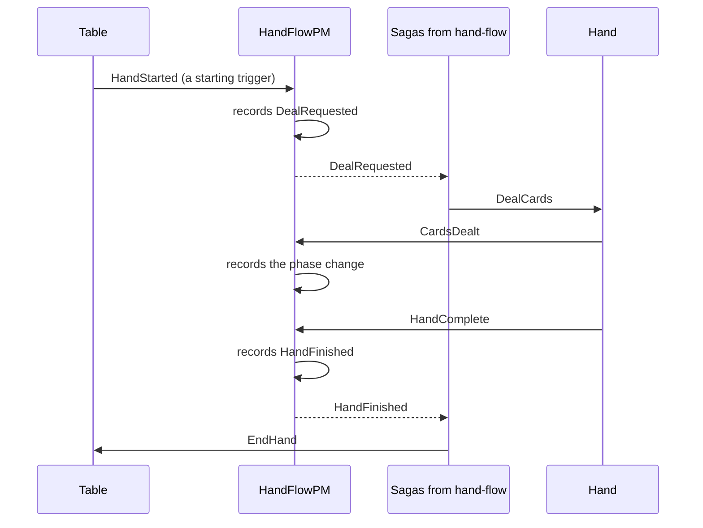

import { Tabs, TabItem } from '@astrojs/starlight/components';


A **process manager** coordinates multi-domain workflows with state tracking. Unlike stateless sagas, process managers maintain their own event stream keyed by correlation ID, enabling complex orchestration patterns.

A process manager takes **facts in and puts facts out**. Everything it receives already happened: trigger events from the domains it subscribes to, and commands addressed to its own domain, which it records and never refuses. Everything it emits is its own events. It sends no commands: to act on another domain it records an event carrying the data that domain's command needs, and a saga from the PM's domain builds the command.

---

## When to Use Process Managers

| Use Case | Saga | Process Manager |
|----------|------|-----------------|
| Single event → single command | ✓ | |
| Fan-out to multiple domains | ✓ (one saga per destination) | |
| Multi-step workflow with state | | ✓ |
| Events from multiple domains | | ✓ |
| State machine transitions | | ✓ |
| Timeouts and retries | | ✓ |

### Warning: Process Manager Anti-Patterns

**Over-reliance on process managers is a foot-gun.** If you find yourself:

- Putting significant business logic in a PM
- Building PMs with large, complex state
- Creating PMs for workflows within a single domain
- Reaching for PMs as a first solution

**Your domain factoring is probably wrong.**

Process managers should be **lightweight state machines** coordinating across domains—not business logic containers. They answer "what phase are we in?" and "what happens next?", not "how do we calculate X?"

| Symptom | Likely Problem |
|---------|----------------|
| PM has complex validation logic | Logic belongs in domain aggregate |
| PM state mirrors aggregate state | Redundant—query the aggregate |
| PM handles single-domain workflow | Use saga or aggregate instead |
| PM event stream grows large | Too much responsibility—split domains |

**Rule of thumb:** If a PM does more than track phases and record what should happen next, reconsider your architecture. The PM's job is orchestration, not computation.

---

## Example: Hand Flow PM

The HandFlowPM orchestrates poker hand phases across table and hand domains. It records each next step as its own event; the sagas from its domain turn those events into commands:



:::caution[Example code predates the contract]
The Python snippets below come from the examples repository, which still shows a PM returning commands. Under the current contract (decision 14.31) a PM returns only its own events, and a saga builds each command.
:::

PMs extend the client library's `ProcessManager` base class; handler methods are registered by decorator / attribute / macro. State lives on the instance.

### State Definition

<Tabs>
<TabItem label="Python">

```python file=vendor/examples/python/pmg-hand-flow/hand_flow_pm.py region=pm_state
```

</TabItem>
</Tabs>

### Handler Implementation

<Tabs>
<TabItem label="Python">

```python file=vendor/examples/python/pmg-hand-flow/hand_flow_pm.py region=pm_handler
```

</TabItem>
</Tabs>

---

## Correlation ID

Process managers use the **correlation ID** as their aggregate root:

```protobuf file=proto/io/angzarr/v1/types.proto region=cover
```

The PM instance's root **is** the trigger's correlation ID, unchanged. All events in a workflow share the same correlation ID, allowing the PM to:
- Receive events from multiple domains
- Maintain workflow state across events
- Track progress through the state machine
- Record the data each next step needs, for a saga to send on

A command addressed to a PM names its instance: the command's cover is the PM's domain with the instance's correlation ID as its root.

### Which inputs start an instance

A PM declares which of its triggers are **starting** triggers (`starts` on the trigger's `(event)` entry). A trigger for a correlation the PM has no instance for starts one only if it is a starting trigger; any other such trigger is skipped. The skip is not an error: nothing is dead-lettered or alerted, and the source is not refused. A command addressed to a PM always starts an instance when there is none, with empty state.

---

## Facts In, Facts Out

| Input | Where it comes from | How the PM answers |
|-------|---------------------|--------------------|
| **Trigger** | An event from a domain the PM subscribes to | Records its own events; never refuses |
| **Command** | A client or a saga, addressed to the PM's own domain | Records it as a fact; never refuses (no `Handling`; the answer is `APPLIED` or `DUPLICATE`) |

A PM's handler is infallible. There is no business rejection of a PM's input: a PM that wanted to refuse a request records the refusal as an event, or the request belongs to an aggregate. A failing handler is a bug: a trigger is dead-lettered and alerted, and a command is dead-lettered and alerted with its sender answered `PARKED`.

Its only output is its own events. To act on another domain, it records an event that carries the command's data, and the saga for (the PM's domain, that domain) builds the command:

```python title="illustrative"
# The PM records what should happen next, with the data the command needs.
def handle_hand_complete(event: HandComplete, state: WorkflowState):
    return PotAwarded(player_root=event.winner_root, amount=event.pot)

# The saga from the PM's domain to "player" builds the command.
def on_pot_awarded(event: PotAwarded):
    return CommandBook(domain="player", root=event.player_root,
                       command=TransferChips(amount=event.amount))
```

The coordinator, not the handler, deduplicates: a redelivered trigger or command is found on the PM's stream before the handler runs, and the handler is not called again.

---

## State Persistence

PM state is stored as events in the PM's own event stream:

```text title="illustrative - PM event stream"
PM Event Stream (correlation_id = "hand-abc-123"):
  [0] WorkflowStarted { hand_id: "...", phase: "awaiting_deal" }
  [1] PhaseTransitioned { from: "awaiting_deal", to: "dealing" }
  [2] PhaseTransitioned { from: "dealing", to: "blinds" }
  [3] WorkflowCompleted { winner_id: "..." }
```

On restart, the PM rebuilds state by replaying its own events.

---

## Replies

A PM tracks the replies to the steps it starts. Its event carries the trigger's correlation ID, so the saga's command built from it carries that correlation, and so do the target's events. The PM subscribes to the target's domain and receives those events as triggers under the same correlation.

A target that refuses records the refusal as a domain event, which reaches the PM as a trigger like any other reply; the PM decides the next step from its own state. There is no notification or compensation channel. A hard rejection of the saga's command (a gRPC error) is retried when retryable and otherwise dead-lettered, as for any saga command.

---

## Timeouts

:::note[Future Feature]
PM-scheduled timeouts (e.g., player action timers, turn clocks) are planned but not yet implemented.

See [Roadmap](../roadmap#process-manager-timeouts) for details.
:::

---

## PM vs Saga

| Aspect | Saga | Process Manager |
|--------|------|-----------------|
| **State** | Stateless | Stateful (own event stream) |
| **Identity** | None | correlation_id |
| **Input domains** | Single | Multiple, plus commands addressed to its own domain |
| **Output** | Commands for its one destination domain | Its own events only |
| **Owned stream** | None (`domain` must be empty) | Its own workflow domain (`domain` required) |
| **Persistence** | No | Yes (workflow events) |
| **Timeouts** | No | Planned |
| **Complexity** | Low | Higher |

A component declares three separate domain roles in `ComponentOptions`: `domain` is the stream it owns, `input_domain` / `(event).domain` are the domains it subscribes to, and `output_domain` is the one domain a saga sends commands to. A process manager declares `domain` and its trigger domains, and no `output_domain`: it sends no commands.

**Rule of thumb**: Start with sagas. Upgrade to PM when you need state tracking or multi-domain input.

---

## Next Steps

- **[Sagas](/components/saga)** — Simpler stateless coordination
- **[Commands vs Facts](/features/facts)** — Commands, facts, and why a PM records both as facts
- **[Why Poker](/examples/why-poker#5-process-manager-orchestration)** — PM patterns in poker
- **[Testing](/operations/testing)** — Testing PMs with Gherkin
