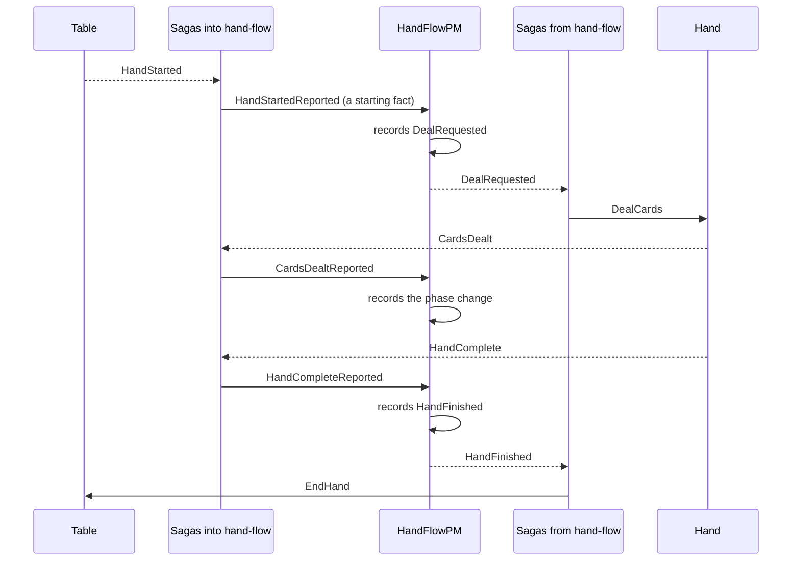

import { Tabs, TabItem } from '@astrojs/starlight/components';


A **process manager** coordinates multi-domain workflows with state tracking. Unlike stateless sagas, process managers maintain their own event stream keyed by correlation ID, enabling complex orchestration patterns.

A process manager takes **facts only**. Its only input is facts addressed to it, which it records and never refuses. It subscribes to no domain: when it must know what happened in another domain, a saga from that domain turns the event into a fact for it. It takes no commands. Everything it emits is its own events: to act on another domain it records an event carrying the data that domain's command needs, and a saga from the PM's domain builds the command.

---

## When to Use Process Managers

| Use Case | Saga | Process Manager |
|----------|------|-----------------|
| Single event → single command | ✓ | |
| Fan-out to multiple domains | ✓ (one saga per destination) | |
| Multi-step workflow with state | | ✓ |
| Gathers what happened in several domains (as facts, through sagas) | | ✓ |
| State machine transitions | | ✓ |
| Timeouts and retries | | ✓ |

### Warning: Process Manager Anti-Patterns

**Over-reliance on process managers is a foot-gun.** If you find yourself:

- Putting significant business logic in a PM
- Building PMs with large, complex state
- Creating PMs for workflows within a single domain
- Reaching for PMs as a first solution

**Your domain factoring is probably wrong.**

Process managers should be **lightweight state machines** coordinating across domains—not business logic containers. They answer "what phase are we in?" and "what happens next?", not "how do we calculate X?"

| Symptom | Likely Problem |
|---------|----------------|
| PM has complex validation logic | Logic belongs in domain aggregate |
| PM state mirrors aggregate state | Redundant—query the aggregate |
| PM handles single-domain workflow | Use saga or aggregate instead |
| PM event stream grows large | Too much responsibility—split domains |

**Rule of thumb:** If a PM does more than track phases and record what should happen next, reconsider your architecture. The PM's job is orchestration, not computation.

---

## Example: Hand Flow PM

The HandFlowPM orchestrates poker hand phases across table and hand domains. Sagas into its domain tell it what happened, as facts; it records each next step as its own event; sagas from its domain turn those events into commands:



:::caution[Example code predates the contract]
The Python snippets below come from the examples repository, which still shows a PM reacting to other domains' events and returning commands. Under the current contract (decision 14.31) a PM takes only facts, which sagas send it, and returns only its own events, from which sagas build each command.
:::

PMs extend the client library's `ProcessManager` base class; handler methods are registered by decorator / attribute / macro. State lives on the instance.

### State Definition

<Tabs>
<TabItem label="Python">

```python file=vendor/examples/python/pmg-hand-flow/hand_flow_pm.py region=pm_state
```

</TabItem>
</Tabs>

### Handler Implementation

<Tabs>
<TabItem label="Python">

```python file=vendor/examples/python/pmg-hand-flow/hand_flow_pm.py region=pm_handler
```

</TabItem>
</Tabs>

---

## Correlation ID

Process managers use the **correlation ID** as their aggregate root:

```protobuf file=proto/io/angzarr/v1/types.proto region=cover
```

The PM instance's root **is** the workflow's correlation ID, unchanged. A fact addressed to a PM names its instance: its cover is the PM's domain with the instance's correlation ID as its root (and its `correlation_id` must agree). A saga that tells a PM about an event addresses the instance that event's correlation names. All events in a workflow share the same correlation ID, allowing the PM to:
- Hear, through sagas, what happened in several domains
- Maintain workflow state across facts
- Track progress through the state machine
- Record the data each next step needs, for a saga to send on

### Which facts start an instance

A PM declares which of its fact types are **starting** facts (`starts` on the fact's `(command)` entry). A fact for a correlation the PM has no instance for starts one only if its type is a starting fact; any other such fact is skipped, silently: nothing is recorded, dead-lettered or alerted, and the sender is answered `APPLIED` with no events.

---

## Facts Only

| | What it is | Who sends it |
|-|-----------|--------------|
| **Input: a fact** | Something that already happened, addressed to the PM's instance | A saga from another domain (turning that domain's event into a fact), a client or an external system |
| **Output: its own events** | What the PM decided, with the data the next step needs | Sagas from the PM's domain turn them into commands |

A PM takes **no commands**. A command permits rejection, and rejection needs compensation; keeping commands away from PMs keeps both out (decision 14.31, which may be revisited if a real case for a command to a PM appears). A command addressed to a PM is refused `INVALID_ARGUMENT`.

A PM's handler is infallible. There is no business rejection of a PM's input: a PM that wanted to refuse a request records the refusal as an event, or the request belongs to an aggregate. A failing handler is a bug: the fact is dead-lettered and alerted, and a sender that waits is answered `PARKED`.

```python title="illustrative"
# The saga from "hand" to the PM's domain tells the PM, as a fact.
def on_hand_complete(event: HandComplete, ctx: SagaContext):
    return FactBook(domain="hand-flow", root=ctx.correlation_id,
                    fact=HandCompleteReported(winner_root=event.winner_root,
                                              pot=event.pot))
```

Its only output is its own events. To act on another domain, it records an event that carries the command's data, and the saga for (the PM's domain, that domain) builds the command:

```python title="illustrative"
# The PM records what should happen next, with the data the command needs.
def handle_hand_complete(fact: HandCompleteReported, state: WorkflowState):
    return PotAwarded(player_root=fact.winner_root, amount=fact.pot)

# The saga from the PM's domain to "player" builds the command.
def on_pot_awarded(event: PotAwarded):
    return CommandBook(domain="player", root=event.player_root,
                       command=TransferChips(amount=event.amount))
```

The coordinator, not the handler, deduplicates: a redelivered fact is found on the PM's stream by its id before the handler runs, and the handler is not called again. A saga's fact gets its id from the event it reacts to, so a saga re-run sends the same id.

---

## State Persistence

PM state is stored as events in the PM's own event stream:

```text title="illustrative - PM event stream"
PM Event Stream (correlation_id = "hand-abc-123"):
  [0] WorkflowStarted { hand_id: "...", phase: "awaiting_deal" }
  [1] PhaseTransitioned { from: "awaiting_deal", to: "dealing" }
  [2] PhaseTransitioned { from: "dealing", to: "blinds" }
  [3] WorkflowCompleted { winner_id: "..." }
```

On restart, the PM rebuilds state by replaying its own events.

---

## Replies

A PM tracks the replies to the steps it starts. Its event carries the instance's correlation ID, so the saga's command built from it carries that correlation, and so do the target's events. The saga from the target's domain to the PM's domain turns the replies the PM must know about into facts, addressed to the instance under that correlation.

A target that refuses records the refusal as a domain event, which reaches the PM as a fact like any other reply; the PM decides the next step from its own state. There is no notification or compensation channel. A hard rejection of the saga's command (a gRPC error) is retried when retryable and otherwise dead-lettered, as for any saga command.

---

## Timeouts

:::note[Future Feature]
PM-scheduled timeouts (e.g., player action timers, turn clocks) are planned but not yet implemented.

See [Roadmap](../roadmap#process-manager-timeouts) for details.
:::

---

## PM vs Saga

| Aspect | Saga | Process Manager |
|--------|------|-----------------|
| **State** | Stateless | Stateful (own event stream) |
| **Identity** | None | correlation_id |
| **Input** | Events of its one source domain | Facts addressed to it (subscribes to no domain) |
| **Output** | Commands for an aggregate's domain, or facts for a PM's | Its own events only |
| **Owned stream** | None (`domain` must be empty) | Its own workflow domain (`domain` required) |
| **Persistence** | No | Yes (workflow events) |
| **Timeouts** | No | Planned |
| **Complexity** | Low | Higher |

A component declares three separate domain roles in `ComponentOptions`: `domain` is the stream it owns, `input_domain` / `(event).domain` are the domains it subscribes to, and `output_domain` is the one domain a saga sends to. A process manager declares only `domain`: it subscribes to nothing and sends nothing but its own events.

**Rule of thumb**: Start with sagas. Upgrade to PM when you need state tracking across steps or what happened in several domains.

---

## Next Steps

- **[Sagas](/components/saga)** — Simpler stateless coordination
- **[Commands vs Facts](/features/facts)** — Commands, facts, and why a PM records both as facts
- **[Why Poker](/examples/why-poker#5-process-manager-orchestration)** — PM patterns in poker
- **[Testing](/operations/testing)** — Testing PMs with Gherkin
