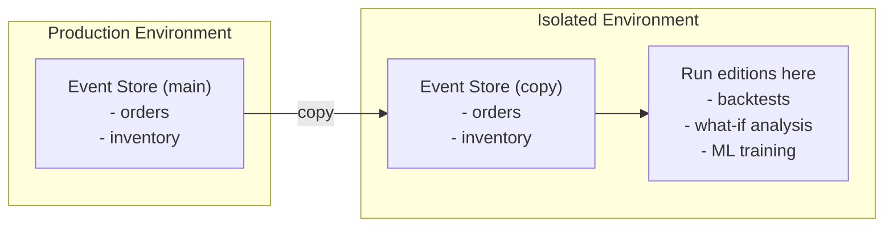

"What if we had approved that claim?" Run the simulation without touching production.

---

## The Concept

An **edition** is a branch of history, made of per-stream forks. The main timeline (no edition name) continues undisturbed while you explore an alternate path—a simulation, a what-if analysis, a training scenario.

When you're done, delete the branch. Editions are for exploration, not migration—there is no merge operation. Events build upon each other; merging branch events into the main timeline would corrupt that timeline by inserting events that reference different prior state. The event stream is immutable by design.

If an edition reveals the "correct" outcome (e.g., after dispute resolution), inject facts into the main timeline that adjust state accordingly. The original events remain (providing audit trail), and the corrective facts record the external determination. See [Commands vs Facts](../components/commands-vs-facts) for fact injection patterns.

---

## Why Branch History?

### A/B Testing Business Rules

Before deploying a new fee structure, run last month's transactions through both the old and new rules. Compare outcomes without risking production.

### Regulatory What-If

"What would our exposure have been if we had applied the new risk model six months ago?" Replay history through the alternate model, with full audit trail.

### ML Training Data

Generate thousands of counterfactual game outcomes for reinforcement learning. Each edition branch produces training data with the same structure as production events.

### Speculative Execution

Preview the effects of a command before committing. "Show me what the order would look like after applying this discount"—without persisting until confirmed.

---

## How It Works

An edition is a set of **per-stream forks** (decision 14.32). There is no edition registry: an edition exists exactly as far as its fork events do.

**Forking a stream.** Creating edition `X` forks an origin stream: an `EditionCreated` meta-event is appended to the stream's `X` version at the sequence main would have used next. That event is the first event of `X`'s version of the stream, and its sequence marks main's end and `X`'s start for that stream.

```python title="illustrative - create an edition by forking an origin stream"
admin.fork_stream(Cover(domain="orders", root=order_id, edition="pricing-experiment"))

# Commands on the edition write to the branch, not main
send(Cover(domain="orders", root=order_id, edition="pricing-experiment"),
     ApplyDiscount(order_id=order_id, percent=20))
```

**Reading a stream in an edition.** Each stream reads main's events below its **own** fork sequence, then the edition's own events. Main's later events never reach it.

**The fork travels with the data.** You don't propagate forks yourself. When a saga's command in the edition reaches a stream that isn't forked yet, that arrival forks it (at the stream's own head), and then the command is handled. Streams the edition's activity never touches are never forked. It is eventually consistent, not lazy.

A command you send yourself to a stream the edition hasn't reached is refused (`FAILED_PRECONDITION`, `EDITION_NOT_FORKED`) until propagation forks it, or until you fork it with `ForkStream`. A query of such a stream reads main's version and forks nothing.

**Every fork is per stream.** angzarr orders events per stream only and has no global position, so an edition's streams diverge at their own points, never at one store-wide moment.

---

## Listing and Cleanup

`ListEditions` lists editions from their fork events. When you're done with a simulation, delete it:

```python title="illustrative - edition cleanup"
admin.delete_edition("pricing-experiment")
```

Deleting is an event, ordered like everything else: an `EditionDeleted` meta-event is recorded in the edition's origin streams after the work already in flight there, travels onward through the same saga flows the creations did (each stream it reaches records its own), and only after it has propagated onward are that stream's edition rows removed, the event included. Nothing polls or retries; a removal that genuinely fails is dead-lettered and alerted. A stream the delete can't reach through the saga flows keeps its rows, and the edition stays in `ListEditions`. Once an edition is deleted, a later arrival in it (a saga command, a step's position) is refused `NOT_FOUND` and re-creates nothing: only an explicit `ForkStream` brings the name back. An edition is unknown once every stream of it is deleted, and commands or queries naming it are refused `NOT_FOUND`.

Everything about an edition lives in the edition's own streams and store. The main timeline knows nothing of its creation or deletion: main's streams, outbox, positions and projections are unchanged.

---

## Example: Backtesting a Trading Strategy

```python title="illustrative - backtesting"
# Create the edition by forking the trading stream
edition = f"backtest-{strategy_id}-{date}"
admin.fork_stream(Cover(domain="trading", root=book_id, edition=edition))

# Replay historical market data through new strategy
for market_event in historical_feed(start_date, end_date):
    result = speculate(
        command=EvaluateTrade(
            signal=market_event,
            strategy=new_strategy,
        ),
        edition=edition,
    )
    collect_metrics(result)

# Analyze results
performance = calculate_sharpe_ratio(edition)
print(f"Strategy {strategy_id}: Sharpe = {performance}")

# Cleanup
admin.delete_edition(edition)
```

---

## Example: Training a Poker Bot

```python title="illustrative - training data generation"
# Generate training data from alternate game outcomes
for hand_id in sample_hands(n=10000):
    for alternate_action in possible_actions(hand_id):
        edition = f"train-{hand_id}-{alternate_action}"
        admin.fork_stream(Cover(domain="hand", root=hand_id, edition=edition))

        result = speculate(
            command=PlayerAction(
                hand_id=hand_id,
                action=alternate_action,
            ),
            edition=edition,
        )

        # Extract features and outcomes for PyTorch
        training_sample = extract_features(result)
        dataset.append(training_sample)

        # Cleanup this branch
        admin.delete_edition(edition)
```

---

## Main Timeline Safety

Editions are isolated. Operations on an edition:
- Cannot affect the main timeline
- Cannot affect other editions
- Are visible only to queries that specify that edition

Production continues normally while you experiment.

---

## Regulated Industry Considerations

While edition isolation guarantees prevent experimental data from affecting the main timeline, running experiments on production infrastructure may still raise concerns in regulated environments—auditors may require complete separation of test and production systems regardless of software guarantees.

For these situations, duplicate the event storage and run editions in an isolated environment:



This provides the same analytical capabilities while satisfying regulatory requirements for environment separation.

:::note[Future: PII Stripping Hooks]

A planned feature will add advice hooks for stripping personally identifiable information during event export, similar to the [upcasting](./upcasting) pattern. This will enable copying production events to isolated environments with automatic anonymization.

See [Roadmap](../roadmap#pii-stripping-hooks) for details.

:::

---

## See Also

- [ML training patterns](./ml-training) — Using editions for model training
