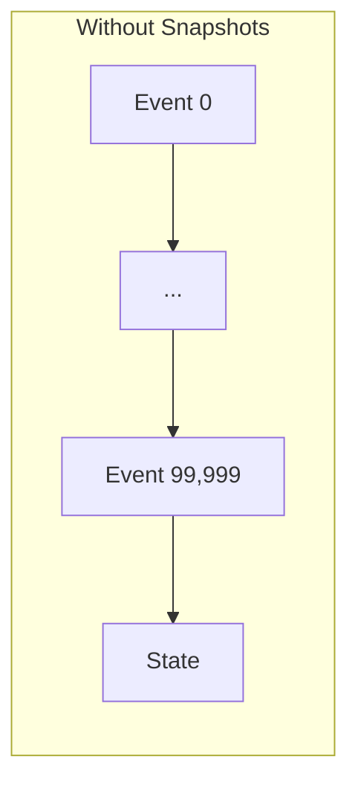
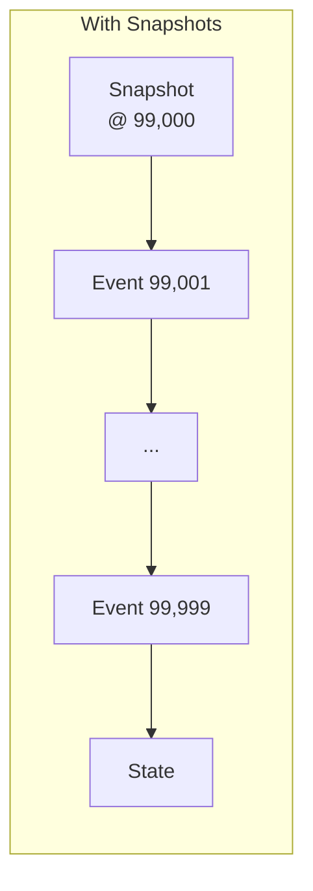
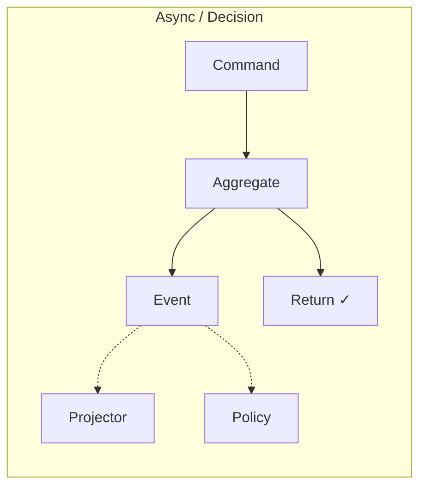
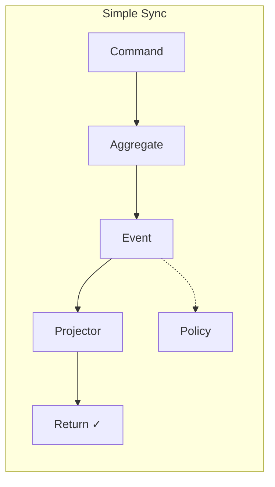
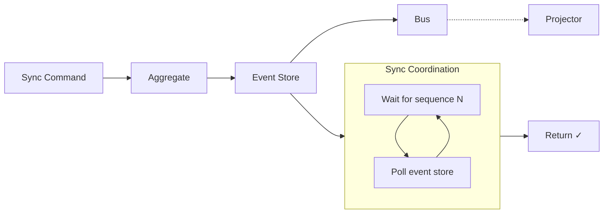
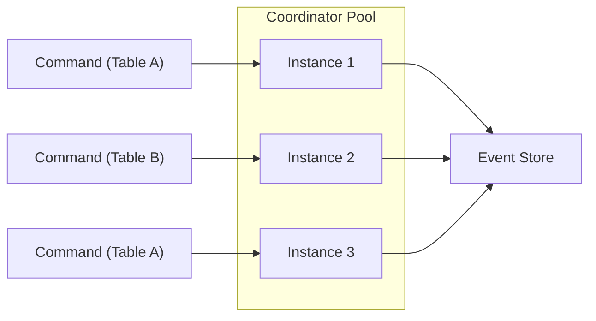
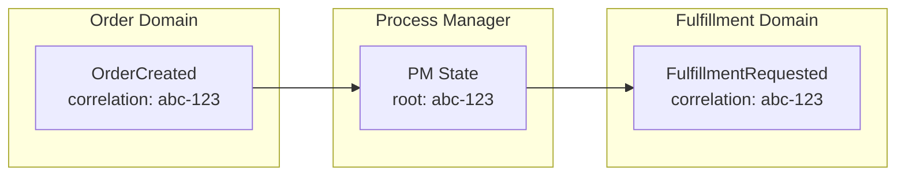

An aggregate with a hundred thousand events. State rebuilt in fifty milliseconds.

---

## The Challenge

Event sourcing rebuilds state by replaying events. A player who's been active for years might have tens of thousands of events. Replaying them on every command would be prohibitive.

The framework provides three mechanisms: snapshots, async processing, and a per-stream optimistic append with no locks.

---

## Snapshots

Snapshots cache aggregate state at intervals, eliminating the need to replay from the beginning:





Without: replay 100,000 events. With: replay 999 events.

### Snapshots Are the Framework's

Business code never decides whether or when to snapshot. Every answer a handler gives carries the state with its events folded in (`HandleResponse.state`), filled by the client library, never by business code; the coordinator persists it as a snapshot per the domain's storage policy, stamped with the answer's rules version (`docs/design/handler-contract.md` §7). A snapshot is offered back only when its state type is the one the component registered and its rules version is compatible (`docs/design/snapshots.md` §3).

### On Command Arrival

On command arrival:

1. **Coordinator** loads the most recent valid snapshot (if any) and the events after it
2. **Client library** folds the snapshot's state and the events into the current state
3. **Aggregate** applies business logic to that state and returns events
4. **Coordinator** appends the events at the head it loaded, and persists the returned state as a snapshot per the storage policy

---

## Synchronicity Modes

**Prefer async.** Sync modes exist for the cases where you genuinely need them, but they work against the grain of event-sourced systems. CQRS achieves scale by decoupling writes from reads—sync modes reintroduce that coupling.

That said, sync modes have legitimate uses: user-facing flows where read-after-write consistency matters, or integration points where downstream systems expect synchronous semantics. Use them surgically, not as a default.

Trade consistency for throughput with three modes, one RPC each:

| Mode | Behavior | Use Case |
|------|----------|----------|
| **Async** (`HandleAsync`) | Validated and enqueued; returns before the decision | High throughput, eventual consistency |
| **Decision** (`Handle`) | Returns the decision and the persisted events | Accept or reject synchronously |
| **Simple** (`HandleSync`) | Also waits for the projectors the call names | Read-after-write for the local domain |





No mode waits for reactions: policies always run asynchronously, and the commands they send are separate commands with their own outcomes. Synchronous cascades across domains were removed (decision 2.1); a caller that needs to see downstream effects follows the command's `correlation_id` on the event stream.

### When to Use Each

| Mode | Latency | Consistency | Example |
|------|---------|-------------|---------|
| Async | Lowest | Eventual | Player folds, leaderboard updates |
| Decision | Low | The decision itself | A bet is accepted or refused |
| Simple | Medium | Local read-after-write | Deposit shows in balance immediately |

Projectors and policies are unaware of the mode: they just process events. The framework decides whether to wait based on the RPC called.

### How Sync Recovery Works

Sync modes cannot simply wait for events to arrive on the bus. Events may be in-flight, delayed, or arrive out of order. To guarantee consistency, the framework **polls the event store directly**:



When a sync command completes, the coordinator knows the resulting event's sequence number. Rather than trusting the bus to deliver events in time, it:

1. Records the expected sequence for each downstream component
2. Polls the event store until those sequences appear in projector checkpoints
3. Only then returns to the caller

This bypasses the bus entirely for consistency—the event store is the source of truth.

---

## Concurrency

When concurrent commands arrive for the same aggregate, the coordinator has no conflict-resolution concept to apply (decision 14.92): no resolution, window or conflict units. It loads the stream, hands the handler the current state, and appends the decision's events **at the head it loaded**. The store's per-stream optimistic append refuses a write whose head has moved, and the coordinator re-runs the command on the new head, under the race re-run cap (a count of runs, default 10, at least 1; decision 14.84). So a handler always decides on current state, and a business rule ("this bet was already placed") is checked by the handler against that state, with its own typed refusal. The rules are `docs/design/pipeline.md` §4 and §5:

```protobuf file=proto/io/angzarr/v1/types.proto region=concurrency
```

Ordering is per stream: a write to another stream never matters.

### The Expected Sequence

A client that decided against the state it read may say so: `Handling.expected_sequence` is the stream's `next_sequence` it decided against. When it is set and is not the head the coordinator loaded, behind or ahead alike, the coordinator refuses the command before the handler is called, `FAILED_PRECONDITION` with the framework's typed refusal `ExpectedSequenceMismatch { expected, head }` (decision 14.94). Nothing is persisted; the caller re-reads, re-decides and re-issues. A command that sets it and then loses a race at its write is re-run, finds the head moved, and is refused the same way.

```text title="illustrative - a stale command"
Command A (expects 5) succeeds; the head is now 6
Command B (expects 5) → FAILED_PRECONDITION, ExpectedSequenceMismatch { expected: 5, head: 6 }
Command C (no expected sequence) → decided on the state at head 6
```

What a caller does with each answer, and what happens at the cap, is in [Error Recovery](/operations/error-recovery#lost-races-and-the-expected-sequence).

---

## Performance Patterns for Poker

| Component | Pattern | Why |
|-----------|---------|-----|
| Hand aggregate | Expected sequence on player actions | Action order matters: a stale action is refused |
| Player aggregate | No expected sequence on deposits | A deposit is decided on whatever the current state is |
| Table aggregate | Snapshots @ 100 | Many events per session |
| Leaderboard projector | Async | Can lag behind |
| Balance projector | Simple sync | Visible immediately |

---

## Benchmarking Guidance

Measure what matters for your domain:

```python title="illustrative - performance benchmarking"
# Command latency
start = time.time()
result = send_command(PlayerAction(...))
latency = time.time() - start
# Target: < 10ms for player actions

# State rebuild time
start = time.time()
state = rebuild_state(event_book)
rebuild_time = time.time() - start
# Target: < 50ms even with 100k events (with snapshots)

# Projection lag
event_time = event.timestamp
projection_time = projection.last_updated
lag = projection_time - event_time
# Target: < 100ms for async, 0 for sync
```

---

## Scaling Horizontally

Aggregate instances are stateless between requests. Each instance can handle any root—the coordinator loads the appropriate EventBook and re-initializes state on every command:



Any coordinator instance handles any root. The event store is the single source of truth—instances don't cache state across requests. This enables:

- **Horizontal scaling**: Add instances based on command throughput
- **No sticky routing**: Load balancer distributes freely
- **No cross-instance coordination**: Optimistic concurrency via sequence numbers

Scale by adding coordinator instances. The event store becomes the bottleneck at extreme scale—every command reads the aggregate's event history and writes new events. [Snapshots](#snapshots) reduce read amplification by caching state at intervals, but writes remain sequential per aggregate root.

---

## Process Managers and Correlation IDs

When workflows span multiple domains, **correlation IDs become aggregate roots** in process managers. The PM is itself an aggregate—its root is the correlation ID identifying the cross-domain process.



The correlation ID (`abc-123`) flows through all events in the workflow. The PM:

1. Takes commands and facts from several domains (policies into its domain build them from those domains' events), keyed by correlation ID
2. Maintains its own event-sourced state (keyed by correlation ID)
3. Records each next step as its own event; policies from its domain turn those events into commands for other domains, preserving the correlation ID

### Commands vs Facts

A domain takes two kinds of input:

| Input | Validation | Can Reject | Use Case |
|-------|------------|------------|----------|
| **Command** | Decided by the handler | Yes | Request an action that may fail |
| **Fact** | Recorded by its handler, never refused | No | Assert external reality the domain must accept |

Facts represent things that have already happened—the aggregate cannot reject reality. Examples:

- "Payment processor confirmed charge" → Order aggregate must record it
- "Tournament system assigned seating" → Table aggregate must honor it

A policy emits what its destination declares (decision 14.69): a command for a type the destination declares a command, which it may refuse, and a fact for one it declares a fact, which it records. A policy also delivers the refusal fact of a refused command, translated by its one refusal callback, to the stream of the event that triggered it.

```python title="illustrative - policy reacting with an output"
# The output names only the destination root and the payload;
# the coordinator addresses and stamps the rest.
return [Output(root=player_root, command=DeductChips(amount=100))]
```

See **[Commands vs Facts](/features/facts)** for idempotency handling, external system integration, and detailed examples.

This enables complex orchestration patterns:

| Pattern | Description |
|---------|-------------|
| **Policy** | Stateless domain translation (no PM needed) |
| **Choreography** | Domains react to events independently |
| **Orchestration** | PM coordinates sequence, handles failures |

PMs scale the same way as aggregates—each correlation ID is independent. A PM instance can handle any correlation ID; the event store partitions by root.

:::note
Policies are stateless translators (one domain → one domain). When you need to correlate events across multiple domains or maintain workflow state, use a process manager. The correlation ID is your aggregate root.
:::

---

## See Also

- [Architecture](../architecture) — How coordinators manage aggregates
- [Commands vs Facts](./facts) — When to use facts over commands
- [Observability](./observability) — Monitoring performance
- [Operations: Infrastructure](../operations/infrastructure) — Deployment patterns
