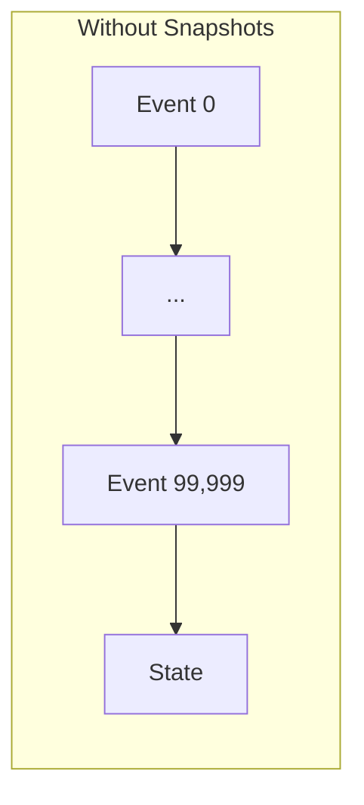
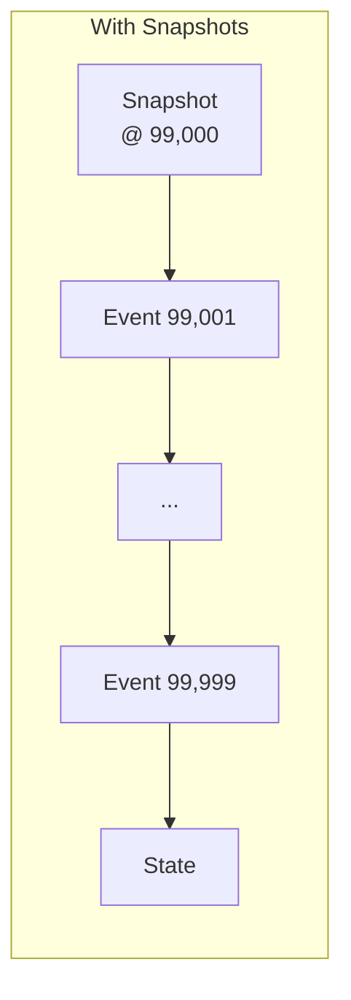
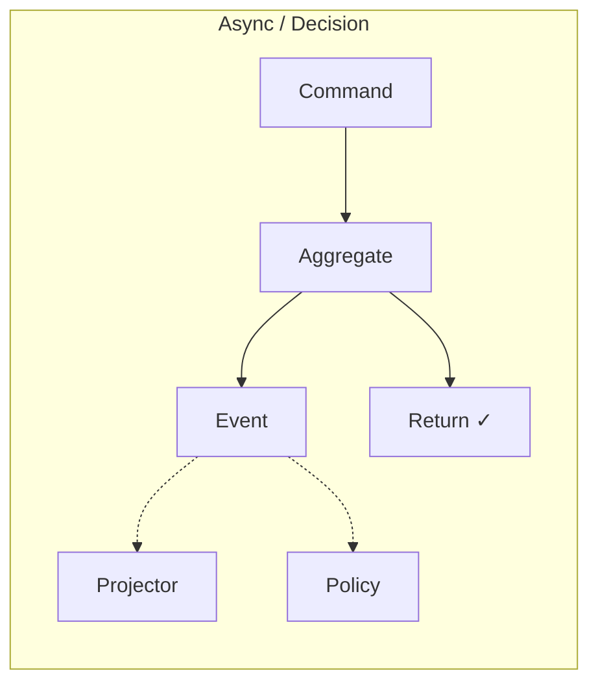
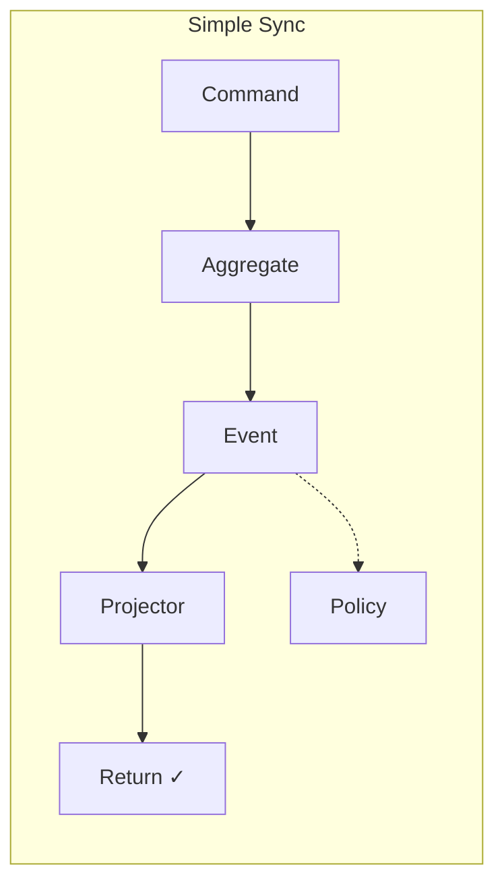
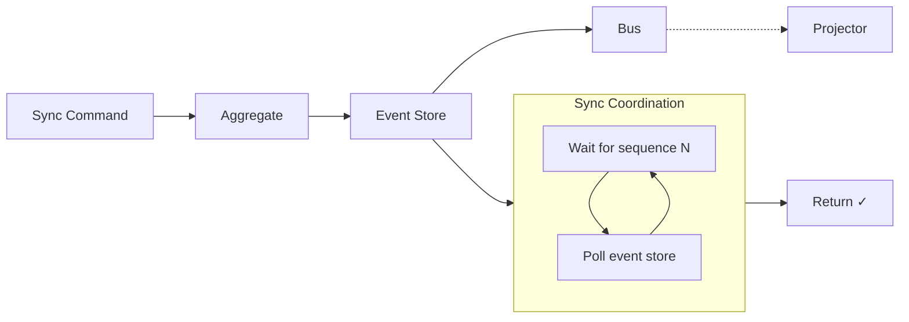
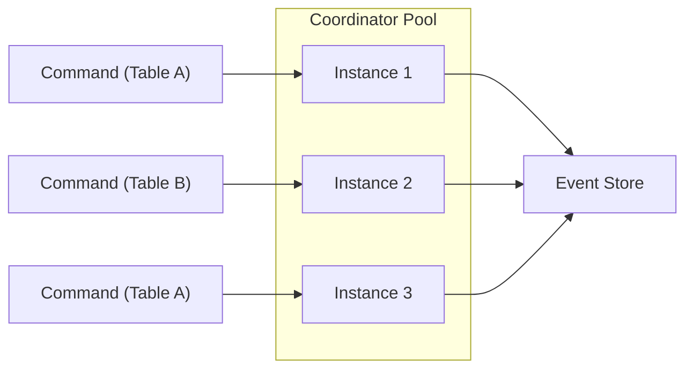
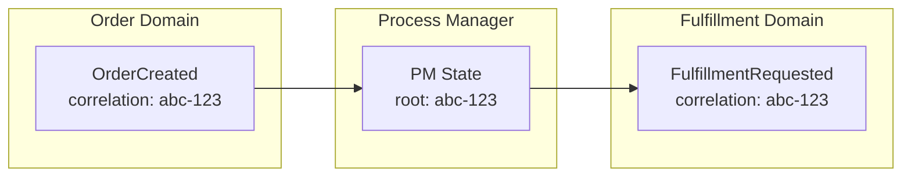

An aggregate with a hundred thousand events. State rebuilt in fifty milliseconds.

---

## The Challenge

Event sourcing rebuilds state by replaying events. A player who's been active for years might have tens of thousands of events. Replaying them on every command would be prohibitive.

The framework provides three mechanisms: snapshots, async processing, and conflict resolution.

---

## Snapshots

Snapshots cache aggregate state at intervals, eliminating the need to replay from the beginning:





Without: replay 100,000 events. With: replay 999 events.

### Client-Driven Snapshotting

The aggregate handler decides when to snapshot by including state in the EventBook:

```python title="illustrative - client-driven snapshotting"
def handle_command(cmd, event_book):
    state = build_state(event_book)
    event = compute(cmd, state)

    # Include snapshot state when appropriate
    new_state = apply_event(state, event)
    if should_snapshot(event_book, new_state):
        event_book.snapshot.state = Any.pack(new_state)

    return event_book

def should_snapshot(event_book, state):
    # Snapshot every 1000 events
    return len(event_book.pages) > 0 and state.event_count % 1000 == 0
```

The framework persists the snapshot automatically when the handler provides state. The aggregate owns the decision logic—snapshot after N events, after certain event types, or based on state size.

### On Command Arrival

On command arrival:

1. **Coordinator** loads the most recent snapshot (if any) and events after that sequence
2. **Aggregate** receives snapshot and events, reconstructs state by replaying events
3. **Aggregate** receives command, applies business logic to reconstructed state, returns events
4. **Coordinator** persists events and snapshot (if the handler included state)

---

## Synchronicity Modes

**Prefer async.** Sync modes exist for the cases where you genuinely need them, but they work against the grain of event-sourced systems. CQRS achieves scale by decoupling writes from reads—sync modes reintroduce that coupling.

That said, sync modes have legitimate uses: user-facing flows where read-after-write consistency matters, or integration points where downstream systems expect synchronous semantics. Use them surgically, not as a default.

Trade consistency for throughput with three modes, one RPC each:

| Mode | Behavior | Use Case |
|------|----------|----------|
| **Async** (`HandleAsync`) | Validated and enqueued; returns before the decision | High throughput, eventual consistency |
| **Decision** (`Handle`) | Returns the decision and the persisted events | Accept or reject synchronously |
| **Simple** (`HandleSync`) | Also waits for the domain's synchronous projectors | Read-after-write for the local domain |





No mode waits for reactions: policies always run asynchronously, and the commands they send are separate commands with their own outcomes. Synchronous cascades across domains were removed (decision 2.1); a caller that needs to see downstream effects follows the command's `correlation_id` on the event stream.

### When to Use Each

| Mode | Latency | Consistency | Example |
|------|---------|-------------|---------|
| Async | Lowest | Eventual | Player folds, leaderboard updates |
| Decision | Low | The decision itself | A bet is accepted or refused |
| Simple | Medium | Local read-after-write | Deposit shows in balance immediately |

Projectors and policies are unaware of the mode: they just process events. The framework decides whether to wait based on the RPC called.

### How Sync Recovery Works

Sync modes cannot simply wait for events to arrive on the bus. Events may be in-flight, delayed, or arrive out of order. To guarantee consistency, the framework **polls the event store directly**:



When a sync command completes, the coordinator knows the resulting event's sequence number. Rather than trusting the bus to deliver events in time, it:

1. Records the expected sequence for each downstream component
2. Polls the event store until those sequences appear in projector checkpoints
3. Only then returns to the caller

This bypasses the bus entirely for consistency—the event store is the source of truth.

---

## Conflict Resolution

When concurrent commands arrive for the same aggregate, a command that names the head it was decided against (its expected sequence) may find the stream has moved. Its conflict resolution decides what happens. The rules, normative, are the `ConflictResolution` region of `io/angzarr/v1/types.proto`:

```protobuf file=proto/io/angzarr/v1/types.proto region=conflict_resolution
```

Ordering is per stream: a write to another stream is never a conflict. An expected sequence *ahead* of the head is not a conflict at all: it is malformed under every resolution, refused `INVALID_ARGUMENT`, `COORDINATOR_REASON_EXPECTED_SEQUENCE_AHEAD` (decision 14.47). A command with no expected sequence is stamped with the head and never stale; a race lost at its write re-runs it on the new head, under the race re-run cap (decision 14.46).

### COMMUTATIVE (the default where the state supports it)

The command is delivered with the events it did not see (the window). `decide` runs on the head state, so its invariants are checked against the window's effects. The client library then computes the **conflict units** the window changed and those the command's events change, from the state message's markers (the `conflict_units` region of `io/angzarr/v1/options.proto`), and the coordinator compares the two sets (decision 14.42). Disjoint: the events are kept. Overlapping: `ABORTED`, `COORDINATOR_REASON_CONFLICT_OVERLAP`, and nothing is persisted. There is no Replay RPC: the coordinator never reads a state, it compares unit paths.

```text title="illustrative - disjoint units (kept)"
Player stream, head 6; the command expected 5
Window (sequence 5) changed:  {display_name}
Command DepositFunds changes: {bankroll}

Disjoint → the command's events are persisted at sequence 6
```

```text title="illustrative - overlapping units (refused)"
Player stream, head 6; the command expected 5
Window (sequence 5) changed:   {bankroll}
Command WithdrawFunds changes: {bankroll}

Overlap → ABORTED, COORDINATOR_REASON_CONFLICT_OVERLAP
```

Fields left unmarked conflict with everything, so an unmarked change can only make COMMUTATIVE stricter. A state supports COMMUTATIVE only when it declares conflict units; otherwise the default is STRICT.

### STRICT

A command behind the head is refused `ABORTED`, `COORDINATOR_REASON_EXPECTED_SEQUENCE_STALE` (args `expected`, `actual`), before business code, or at the write if another write to the same stream lands first. Nothing is persisted and the command is never re-run: the caller re-reads, re-decides and re-issues (decision 14.45). Use it where the caller's intent depends on exactly the state it read.

```text title="illustrative - strict rejection"
Command A (expects 5) succeeds; the head is now 6
Command B (expects 5) → ABORTED, COORDINATOR_REASON_EXPECTED_SEQUENCE_STALE
```

### AGGREGATE_HANDLES

`decide` receives the window with a nonce and applies its own conflict rule. It must call `resolve_conflicts(...)` with that nonce before it returns; one that does not fails `ABORTED`, `COORDINATOR_REASON_CONFLICT_UNRESOLVED`, exactly as STRICT would have (decision 14.42).

What a caller does with each answer, and what happens at a retry cap, is in [Error Recovery](/operations/error-recovery#sequence-conflicts).

---

## Performance Patterns for Poker

| Component | Pattern | Why |
|-----------|---------|-----|
| Hand aggregate | STRICT | Action order matters |
| Player aggregate | COMMUTATIVE | Deposits touch only the bankroll |
| Table aggregate | Snapshots @ 100 | Many events per session |
| Leaderboard projector | Async | Can lag behind |
| Balance projector | Simple sync | Visible immediately |

---

## Benchmarking Guidance

Measure what matters for your domain:

```python title="illustrative - performance benchmarking"
# Command latency
start = time.time()
result = send_command(PlayerAction(...))
latency = time.time() - start
# Target: < 10ms for player actions

# State rebuild time
start = time.time()
state = rebuild_state(event_book)
rebuild_time = time.time() - start
# Target: < 50ms even with 100k events (with snapshots)

# Projection lag
event_time = event.timestamp
projection_time = projection.last_updated
lag = projection_time - event_time
# Target: < 100ms for async, 0 for sync
```

---

## Scaling Horizontally

Aggregate instances are stateless between requests. Each instance can handle any root—the coordinator loads the appropriate EventBook and re-initializes state on every command:



Any coordinator instance handles any root. The event store is the single source of truth—instances don't cache state across requests. This enables:

- **Horizontal scaling**: Add instances based on command throughput
- **No sticky routing**: Load balancer distributes freely
- **No cross-instance coordination**: Optimistic concurrency via sequence numbers

Scale by adding coordinator instances. The event store becomes the bottleneck at extreme scale—every command reads the aggregate's event history and writes new events. [Snapshots](#snapshots) reduce read amplification by caching state at intervals, but writes remain sequential per aggregate root.

---

## Process Managers and Correlation IDs

When workflows span multiple domains, **correlation IDs become aggregate roots** in process managers. The PM is itself an aggregate—its root is the correlation ID identifying the cross-domain process.



The correlation ID (`abc-123`) flows through all events in the workflow. The PM:

1. Takes commands and facts from several domains (policies into its domain build them from those domains' events), keyed by correlation ID
2. Maintains its own event-sourced state (keyed by correlation ID)
3. Records each next step as its own event; policies from its domain turn those events into commands for other domains, preserving the correlation ID

### Commands vs Facts

A domain takes two kinds of input:

| Input | Validation | Can Reject | Use Case |
|-------|------------|------------|----------|
| **Command** | Decided by the handler | Yes | Request an action that may fail |
| **Fact** | Recorded by its handler, never refused | No | Assert external reality the domain must accept |

Facts represent things that have already happened—the aggregate cannot reject reality. Examples:

- "Payment processor confirmed charge" → Order aggregate must record it
- "Tournament system assigned seating" → Table aggregate must honor it

A policy emits **commands** only. The one fact a policy delivers is a refusal fact: a refusal of its command, recorded in the stream of the event that triggered it.

```python title="illustrative - policy emitting a command"
# Policy emitting a command (can be refused)
yield Command(domain="player", type=DeductChips(amount=100))
```

See **[Commands vs Facts](/features/facts)** for idempotency handling, external system integration, and detailed examples.

This enables complex orchestration patterns:

| Pattern | Description |
|---------|-------------|
| **Policy** | Stateless domain translation (no PM needed) |
| **Choreography** | Domains react to events independently |
| **Orchestration** | PM coordinates sequence, handles failures |

PMs scale the same way as aggregates—each correlation ID is independent. A PM instance can handle any correlation ID; the event store partitions by root.

:::note
Policies are stateless translators (one domain → one domain). When you need to correlate events across multiple domains or maintain workflow state, use a process manager. The correlation ID is your aggregate root.
:::

---

## See Also

- [Architecture](../architecture) — How coordinators manage aggregates
- [Commands vs Facts](./facts) — When to use facts over commands
- [Observability](./observability) — Monitoring performance
- [Operations: Infrastructure](../operations/infrastructure) — Deployment patterns
