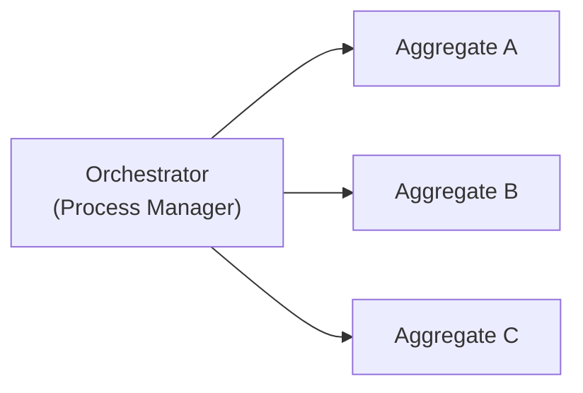
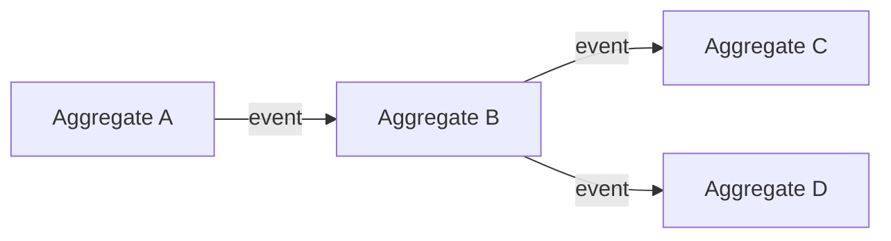

# Orchestration vs Choreography

Two fundamental patterns for coordinating distributed workflows.

## Orchestration

A central coordinator (a process manager) explicitly controls the workflow:

**Characteristics:**
- Central control point
- Explicit workflow definition
- Easier to understand/debug
- Single point of failure

**In Angzarr:** [Process Managers](/glossary/process-manager) implement orchestration: a PM records each next step as its own event, and [policies](/glossary/policy) from its domain turn those events into commands.

## Choreography

Components react independently to events:

**Characteristics:**
- Decentralized control
- Loose coupling
- Harder to trace workflows
- More resilient

**In Angzarr:** Multiple policies can create choreographed behavior by each reacting to different events.

## When to Use Each

| Scenario | Pattern |
|----------|---------|
| Complex multi-step workflow | Orchestration (PM) |
| Simple domain translation | Choreography (Policy) |
| Independent reactions | Choreography |
| Need central monitoring | Orchestration |
| Maximum decoupling | Choreography |

## Hybrid Approach

Angzarr supports combining both:
- Policies for explicit domain translation
- Multiple policies reacting to same events (choreography)
- Process managers for complex orchestration
