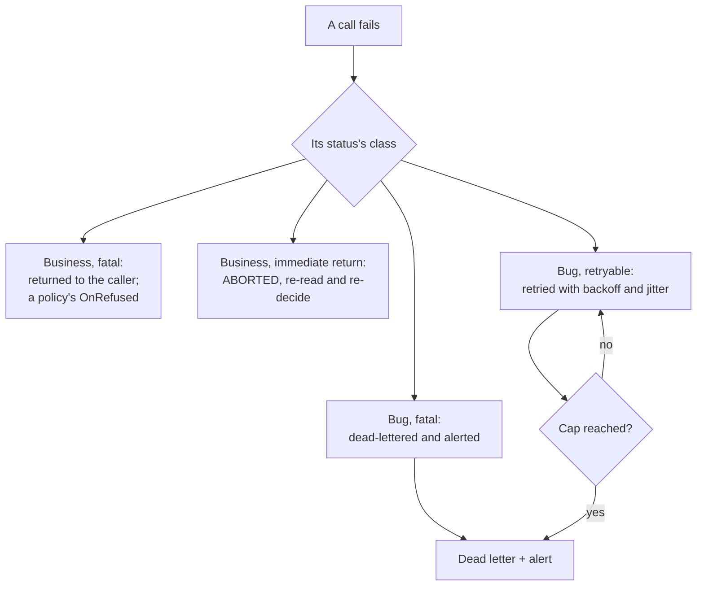

import { Tabs, TabItem } from '@astrojs/starlight/components';


Angzarr's error recovery follows from one rule: the gRPC status alone decides an error's class (decision 14.37), and the class decides what happens next. A business error goes back to its caller; a retryable bug is retried with backoff up to a cap; anything that cannot be finished is dead-lettered and alerted for an operator. A refused policy command becomes a refusal fact for the policy's source domain (see Saga Refusals, below).

---

## Overview



---

## Errors Are Keys, Never English

Every error angzarr sends carries a **key** and an **argument map**, never rendered text (decision 14.37). Text is rendered only where it is displayed (a console, a UI, a client's `message()`), from a [Fluent](https://projectfluent.org/) catalog keyed by the code. A log shows the code and its args as they are.

| Where | The key | The map |
|-------|---------|---------|
| A gRPC status | The status message, and the `google.rpc.ErrorInfo` reason (domain `angzarr.io`) | The `ErrorInfo` metadata |
| A message (`RefusalResponse`, `ProjectorFailure`, `AngzarrDeadLetter`, the DLQ details) | `Diagnostic.code` | `Diagnostic.args` |
| A typed refusal object | Its type (on the wire, reason `ROUTER_REASON_COMMAND_REFUSED` with metadata `refusal_type`) | Its fields |

This holds for business code too. A handler's typed refusal is its refusal object; any other rejection, and every handler bug, carries a diagnostic code and its args. No free text crosses any boundary: a handler bug is answered `ROUTER_REASON_UNHANDLED_HANDLER_ERROR`, carrying the handler's own diagnostic as its cause (a panic's cause is `ROUTER_REASON_HANDLER_PANICKED`), and what the error or panic said stays in the handler's own log. A wrapped cause is flattened into the args: its code under the arg's name and its args under `<name>.<arg>`.

Every distinct condition has its own reason key, so no two conditions share a key and differ only by text. The framework's keys are the enums of `io/angzarr/v1/reasons.proto` (in the Proto API reference), one per component that answers them (`RouterReason`, `HostReason`, `CoordinatorReason`), each value's comment giving its status and args; on the wire a key is the value's full name, its enum's prefix included (`ROUTER_REASON_DUPLICATE_COMPONENT`). Some of them:

| Condition | Reason | Status |
|-----------|--------|--------|
| A fold fails on a persisted event | `ROUTER_REASON_FOLD_FAILED` | `INTERNAL` |
| A fold fails on an event the command emitted | `ROUTER_REASON_FOLD_FAILED_EMITTED` | `INTERNAL` |
| A command type no handler claims, after the coordinator upcast it | `ROUTER_REASON_UNKNOWN_COMMAND_TYPE` (metadata `type_url` as sent, `upcast_type_url` as delivered; the router itself reports only `type_url`, the type it was given) | `INTERNAL` |
| A fact type no handler claims, after the coordinator upcast it | `ROUTER_REASON_NO_FACT_HANDLER` (metadata as for `ROUTER_REASON_UNKNOWN_COMMAND_TYPE`) | `INTERNAL` |
| A pass-through `CommandRefused` the source has no `on_refused_<Command>` for | `ROUTER_REASON_NO_REFUSAL_HANDLER` (metadata `command_type`) | `INTERNAL` |
| A dispatch to a kind the business process does not host | `ROUTER_REASON_NO_COMPONENT_OF_KIND` | `UNIMPLEMENTED` |
| A second component, built with or registered beside the one hosted | `ROUTER_REASON_DUPLICATE_COMPONENT` (metadata `component`, `component_kind`) | `INTERNAL` |
| A policy's translated refusal fact that is more than a payload (the coordinator's check) | One key per fault: `COORDINATOR_REASON_REFUSAL_FACT_ADDRESSED`, `COORDINATOR_REASON_REFUSAL_FACT_NO_PAGE`, `COORDINATOR_REASON_REFUSAL_FACT_NOT_A_FACT`, `COORDINATOR_REASON_REFUSAL_FACT_IDENTIFIED` | `INTERNAL` |
| Bytes that do not decode as the message expected | `ROUTER_REASON_ANY_DECODE_FAILED` (metadata `message_type`, and the decoder's own text as `ext_err_txt`) | `INTERNAL` |

---

## Status Classes

Every status belongs to one of four classes (decision 14.37). The authoritative list is the status-codes comment on `CommandHandlerCoordinatorService` in `io/angzarr/v1/command_handler.proto`; each reason key's status and args are in its value comment in `io/angzarr/v1/reasons.proto`.

| Class | Statuses | What happens |
|-------|----------|--------------|
| Business, fatal | `FAILED_PRECONDITION`, `INVALID_ARGUMENT`, `NOT_FOUND`, `ALREADY_EXISTS`, `OUT_OF_RANGE`, `PERMISSION_DENIED` | Final, never retried. A refused policy command reaches the policy's `OnRefused`. |
| Business, immediate return | `ABORTED` ("re-read and re-decide") | Returned at once to an outside caller, who re-reads and decides again. For a policy step the runtime is the caller: it reloads and re-runs the step under the capped backoff, then dead-letters and alerts. Never `OnRefused`. |
| Bug, fatal | `INTERNAL`, `UNKNOWN`, `DATA_LOSS` | Never retried: dead-lettered and alerted at once. Never `OnRefused`. |
| Bug, retryable | `UNAVAILABLE`, `DEADLINE_EXCEEDED`, `RESOURCE_EXHAUSTED`, `UNIMPLEMENTED` and every other code | Retried, on by default, with exponential backoff and jitter up to the retry cap, then dead-lettered and alerted. Never `OnRefused`. |

The backoff's scale and jitter factor and the retry cap are coordinator configuration. A policy step that reaches the cap, or fails as a fatal bug, moves or keeps the policy's position as its `on_policy_bug` setting says.

### Sequence Conflicts

A command may name the stream head it was decided against (`Handling.expected_sequence`); its conflict resolution (`ConflictResolution` in `io/angzarr/v1/types.proto`) says what happens when the stream has moved. Ordering is per stream: a write to another stream is never a conflict.

| The command | The stream moved | What happens |
|-------------|------------------|--------------|
| Any resolution, with an expected sequence ahead of the head | Never: the command names a sequence the stream has not reached | Malformed: `INVALID_ARGUMENT`, `COORDINATOR_REASON_EXPECTED_SEQUENCE_AHEAD` (args `expected`, `head`), found at load, before business code; nothing persisted, never retried (decision 14.47). |
| `STRICT`, with an expected sequence behind the head | At load, or at the write (another write to the same stream landed first) | `ABORTED`, `COORDINATOR_REASON_EXPECTED_SEQUENCE_STALE` (args `expected`, `actual`); nothing persisted, never re-run. This key is STRICT's alone. |
| `AGGREGATE_HANDLES` or `COMMUTATIVE`, with an expected sequence behind the head | At load | The window (the events the command did not see) is delivered with a fresh nonce, and the resolution's rule decides: an unresolved nonce is `ABORTED` `COORDINATOR_REASON_CONFLICT_UNRESOLVED`, a unit overlap `ABORTED` `COORDINATOR_REASON_CONFLICT_OVERLAP`. Never the stale key. |
| `AGGREGATE_HANDLES` or `COMMUTATIVE`, with an expected sequence | At the write, after the window was delivered | The coordinator re-delivers the widened window with a fresh nonce and the rule decides again, under the retry cap (decision 14.45). |
| No expected sequence (the coordinator stamps the head) | At the write | The coordinator re-runs the command on the new head, waiting with backoff and jitter between runs, under the race re-run cap: a count of runs, the first included, default 10 (decision 14.46). Never the stale key. |

At either cap the command is dead-lettered and alerted, nothing is persisted, and a caller waiting on `Handle` or `HandleSync` is answered `INTERNAL`, `COORDINATOR_REASON_RETRY_CAP_EXHAUSTED` (args `attempts`, `cap`). It is `INTERNAL`, a fatal bug's status, because the retries are spent and the dead letter holds the command: no caller retries it again, and a policy step follows `on_policy_bug`. `HandleAsync` has no caller to answer.

Facts (a timeout, a webhook) are never refused. A fact is always stamped, so a lost race re-runs it under the race re-run cap; at the cap it is dead-lettered and alerted, and its sender is answered "accepted, parked" (OK, `Outcome.delivery` `PARKED`, no events), never the cap key, exactly as for a fact whose ingest handler fails.

### Re-deciding a Stale Command

A STRICT caller answered `COORDINATOR_REASON_EXPECTED_SEQUENCE_STALE` re-reads and re-decides. A caller answered `COORDINATOR_REASON_EXPECTED_SEQUENCE_AHEAD` has a bug, not a conflict: re-reading cannot make that command succeed, so it fixes where its expected sequence came from.

```
1. Command fails ABORTED, reason COORDINATOR_REASON_EXPECTED_SEQUENCE_STALE
   (the ErrorInfo metadata carries expected and actual)
2. Client reloads the stream's state
3. Client re-evaluates its business logic against that state
4. Client builds a new command naming the new head as its expected sequence
5. Client resubmits, up to its own attempt limit
```

:::warning[Rebuild, Don't Just Re-sequence]
Simply updating the sequence number is insufficient. The command's payload may depend on state that changed. You must rebuild the command by re-running your business logic against the fresh state.
:::

---

## Dead Letter Queue (DLQ)

Messages that cannot be processed after retries are routed to a dead letter queue for manual intervention.

### When Messages Go to DLQ

Every dead letter records why in `AngzarrDeadLetter.reason`: a key and its args, never text.

| Scenario | Result |
|----------|--------|
| A fatal bug (`INTERNAL`, `UNKNOWN`, `DATA_LOSS`) | Dead-lettered and alerted at once |
| A retryable bug that reaches the retry cap | Dead-lettered and alerted |
| A race lost at every write until the retry cap or the race re-run cap | Dead-lettered and alerted, reason `COORDINATOR_REASON_RETRY_CAP_EXHAUSTED` (args `attempts`, `cap`); a waiting command caller answered `INTERNAL` with that key, a fact's sender `PARKED` |
| A fact whose ingest handler fails | Dead-lettered and alerted; the sender answered `PARKED` |
| A queued command with a caller-provided expected sequence answered `ABORTED` | Dead-lettered with `SequenceMismatchDetails`: resending it verbatim cannot succeed |
| An event handler (policy, projector) failed | Dead-lettered after its retries |
| A claim-checked payload could not be retrieved | Dead-lettered |

### Topic Naming

DLQ topics are per-domain for isolation:

```
angzarr.dlq.{domain}
```

Examples:
- `angzarr.dlq.player` — Player domain failures
- `angzarr.dlq.hand` — Hand domain failures
- `angzarr.dlq.table` — Table domain failures

### Dead Letter Structure

```protobuf file=proto/io/angzarr/v1/types.proto region=dead_letter
```

### DLQ Backends

| Backend | Topic Format | Use Case |
|---------|--------------|----------|
| Channel | In-memory | Standalone mode, testing |
| AMQP | `angzarr.dlq` exchange | RabbitMQ production |
| Kafka | `angzarr-dlq-{domain}` | Kafka production |
| Pub/Sub | `angzarr-dlq-{domain}` | GCP production |
| SNS/SQS | `angzarr-dlq-{domain}` | AWS production |

### Configuration

```yaml
dlq:
  backend: amqp  # none | channel | amqp | kafka | pubsub | sns_sqs
  amqp_url: "amqp://localhost:5672"
  # OR
  kafka_brokers: "localhost:9092"
  # OR
  aws_region: "us-east-1"
  aws_endpoint_url: "http://localhost:4566"  # LocalStack
```

### Processing DLQ Messages

Dead letters require manual review. Common actions:

1. **Fix and replay** — Correct the issue, resubmit command
2. **Skip** — Mark as handled without replay (data not critical)
3. **Compensate** — Emit compensating events manually
4. **Escalate** — Route to operations team

---

## Saga Refusals

A target that refuses a saga's command (a business rejection, optionally with a typed refusal object) records nothing. The saga's coordinator calls `OnRefused`, and the saga builds one refusal fact for its own source domain: the standard `CommandRefused` passed through with the refusal object packed (the default), or a domestic fact its callback translates the refusal into (where the CLI selects translate at code generation). The fact's id is the refused command's id. The coordinator writes it to the outbox in the same transaction that clears the command's entry. The source records the fact and decides what it means.

| What happened | What happens |
|---------------|--------------|
| A business rejection | The refusal fact goes to the saga's source, retried, deduplicated by the refused command's id |
| A pass-through refusal the source has no handler for | The fact is refused `ROUTER_REASON_NO_REFUSAL_HANDLER`, dead-lettered for a human, and alerted; found only at run time, since nothing declares what a saga sends |
| The translating callback fails | The refusal is dead-lettered and alerted |
| A retryable failure | The command is retried |
| Any other terminal failure | The command is dead-lettered and alerted: a bug |
| A policy's command names no root, whatever its target | Refused `INTERNAL`, `COORDINATOR_REASON_POLICY_COMMAND_NO_ROOT` (with `domain` and `command_type`); dead-lettered and alerted, never delivered |
| A policy's command carries a correlation other than its trigger's | Refused `INTERNAL`, `COORDINATOR_REASON_POLICY_COMMAND_OTHER_CORRELATION`; dead-lettered and alerted, never delivered |

## Process Manager Failures

A process manager is a domain, so its failures are an aggregate's: a refused command records nothing and the sender gets the rejection; a failing fact handler is a bug (the fact is dead-lettered and alerted, a waiting sender answered `PARKED`). An input whose `correlation_id` differs from its root is delivered to that root (decision 14.36). Its start rule is its own:

| What happened | What the coordinator does | What the sender sees |
|---------------|---------------------------|----------------------|
| A non-starting fact for a correlation with no instance | Skips it; nothing is recorded, dead-lettered or alerted | `APPLIED` with no events |
| A non-starting command for a correlation with no instance | Refuses it, recording nothing | `FAILED_PRECONDITION`, `COORDINATOR_REASON_PM_NO_INSTANCE` |

---

## Saga Compensation

:::caution[Removed from the contract]
The compensation and notification path below is deleted from the current contract (backlog RM-2). A target that refuses records nothing; the saga delivers a refusal fact to its own source domain (see Saga Refusals, above). This section describes the prior implementation until the page is rewritten (backlog DOC-2).
:::

When a saga-issued command is rejected, angzarr notifies the original aggregate so it can emit compensation events.

### Compensation Flow

```
1. Saga emits command to target aggregate
2. Target aggregate rejects (business rule violation)
3. Coordinator records a RejectionNotification in its compensation outbox,
   then acknowledges the triggering event
4. Outbox delivers the Notification to the source aggregate
   (at least once; retried with backoff; dead-lettered on exhaustion)
5. Source aggregate emits compensation events
   OR
   Source aggregate returns RevocationResponse flags
```

### Notification vs Event

| Aspect | Notification | Event |
|--------|--------------|-------|
| In the event stream? | Never | Yes |
| Sequence? | No | Yes |
| Delivery | Coordinator outbox, at least once | Bus, from the stream |
| Purpose | Compensation | State change |

Notifications trigger behavior but aren't part of the event stream. Their delivery is durable: see [Delivery Guarantees](/features/compensation#delivery-guarantees).

### RejectionNotification

### Handling Rejections

The source aggregate registers rejection handlers using `@rejected` decorators. The framework dispatches based on the rejected command's domain and type — no if/else chains needed.

<Tabs>
<TabItem label="Python">

**[`examples/python/player/agg/rejected.py`](https://github.com/benjaminabbitt/angzarr/blob/main/examples/python/player/agg/rejected.py)**

```python file=vendor/examples/python/player/agg/rejected.py region=rejected_handler
```

</TabItem>
</Tabs>

### RevocationResponse Flags

When an aggregate cannot handle a rejection, it returns flags:

| Flag | Effect |
|------|--------|
| `emit_system_revocation` | Emit `SagaCompensationFailed` event to fallback domain |
| `send_to_dead_letter_queue` | Route to DLQ for manual review |
| `escalate` | Trigger webhook notification |
| `abort` | Stop saga chain, propagate error to caller |

### Configuration

```yaml
saga_compensation:
  fallback_domain: "system"                    # Domain for SagaCompensationFailed events
  fallback_emit_system_revocation: true        # Default when aggregate returns empty
  fallback_send_to_dlq: true
  fallback_escalate: false
  dead_letter_queue_url: "amqp://..."          # Optional DLQ URL
  escalation_webhook_url: "https://..."        # Optional webhook for alerts
```

---

## Conflict Resolution

`ConflictResolution` (in `io/angzarr/v1/types.proto`) has three values; the rules on a moved stream are under [Sequence Conflicts](#sequence-conflicts), above. Which a stream supports comes from its registered state: every state supports `STRICT` and `AGGREGATE_HANDLES`, and `COMMUTATIVE` only where the state declares conflict units. With none given, the default is `COMMUTATIVE` where supported, else `STRICT`.

| Use Case | Resolution | Why |
|----------|------------|-----|
| Financial operations (balance checks) | `STRICT` | Must see current state |
| Counters, sets of independent items | `COMMUTATIVE` | Disjoint changes commute |
| CRDT-style operations | `AGGREGATE_HANDLES` | The aggregate merges the window itself |

---

## Escalation

For critical failures, angzarr can trigger alerts via webhooks:

```yaml
saga_compensation:
  escalation_webhook_url: "https://ops.example.com/alerts"
```

Webhook payload:

```json
{
  "saga_name": "saga-table-player",
  "triggering_aggregate": {
    "domain": "table",
    "root": "550e8400-e29b-41d4-a716-446655440000"
  },
  "triggering_sequence": 5,
  "reason": { "code": "INSUFFICIENT_FUNDS", "args": { "available": "120", "requested": "500" } },
  "compensation_reason": { "code": "COMPENSATION_EMPTY_RESPONSE" },
  "occurred_at": "2024-01-15T10:30:00Z"
}
```

---

## Best Practices

### 1. Design for Idempotency

Handlers may be retried. Ensure repeated execution produces the same result.

```python
# BAD: Not idempotent
def apply_funds_deposited(state, event):
    state.balance += event.amount  # Adds again on retry!

# GOOD: Idempotent (events have absolute values)
def apply_funds_deposited(state, event):
    state.balance = event.new_balance  # Same result on retry
```

### 2. Choose the Conflict Resolution Deliberately

Use `STRICT` where a decision must see the current state, and `COMMUTATIVE` or `AGGREGATE_HANDLES` where a stale decision can still be judged safe (see [Conflict Resolution](#conflict-resolution)).

### 3. Handle Notifications Explicitly

Don't ignore `RejectionNotification` — either compensate or escalate:

```python
def handle_rejection(state, rejection):
    if can_compensate(rejection):
        return build_compensation_event(rejection)
    else:
        return RevocationResponse(
            send_to_dead_letter_queue=True,
            escalate=True,
            reason="CANNOT_COMPENSATE",
        )
```

### 4. Monitor DLQ Depth

Set up alerts for DLQ message accumulation:

```yaml
# Prometheus alert
- alert: DLQBacklog
  expr: dlq_messages_total > 100
  for: 5m
  labels:
    severity: warning
```

---

## Next Steps

- **[Patterns Reference](/reference/patterns)** — Conflict resolution, SyncMode details
- **[Sagas](/components/saga)** — Cross-domain coordination
- **[Payload Offloading](/operations/payload-offloading)** — Large message handling
