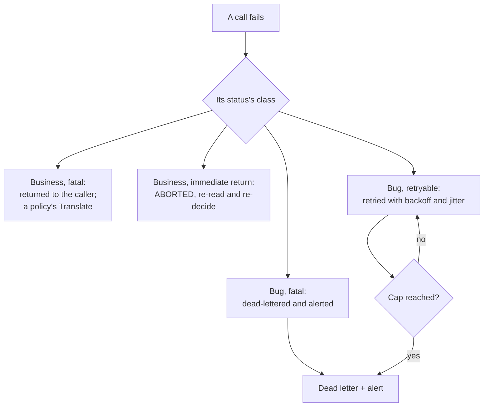

Angzarr's error recovery follows from one rule: the gRPC status alone decides an error's class (decision 14.37), and the class decides what happens next. A business error goes back to its caller; a retryable bug is retried with backoff up to a cap; anything that cannot be finished is dead-lettered and alerted for an operator. A refused policy command becomes a refusal fact for the policy's source domain (see Policy Refusals, below).

---

## Overview



---

## Errors Are Keys, Never English

Every error angzarr sends carries a **key** and an **argument map**, never rendered text (decision 14.37). Text is rendered only where it is displayed (a console, a UI, a client's `message()`), from a [Fluent](https://projectfluent.org/) catalog keyed by the code. A log shows the code and its args as they are.

| Where | The key | The map |
|-------|---------|---------|
| A gRPC status | The status message, and the `google.rpc.ErrorInfo` reason (domain `angzarr.io`) | The `ErrorInfo` metadata |
| A message (`AngzarrDeadLetter`'s `reason` arm) | `Diagnostic.code` | `Diagnostic.args` |
| A typed refusal object | Its type (on the wire, reason `ANGZARR_REASON_COMMAND_REFUSED` with metadata `refusal_type`) | Its fields |

This holds for business code too. A handler's refusal is always typed, its refusal object (decision 14.95); a re-run (`ABORTED`) and every handler bug carry a diagnostic code and its args. No free text crosses any boundary: a handler bug is answered `ANGZARR_REASON_UNHANDLED_HANDLER_ERROR`, carrying the handler's own diagnostic as its cause (a panic's cause is `ANGZARR_REASON_HANDLER_PANICKED`), and what the error or panic said stays in the handler's own log. A wrapped cause is flattened into the args: its code under the arg's name and its args under `<name>.<arg>`.

Every distinct condition has its own reason key, so no two conditions share a key and differ only by text. The framework's keys are the enums of `io/angzarr/v1/reasons.proto` (in the Proto API reference), one per layer: core's `AngzarrReason` (`ANGZARR_REASON_*`), and each transport's own `reasons.proto` for what only it raises (`io/angzarr/transport/embedded/v1`'s `EmbeddedReason`, `EMBEDDED_REASON_*`: a child process's keys; `io/angzarr/transport/distributed/v1`'s `DistributedReason`, `DISTRIBUTED_REASON_*`: a distributed coordinator's; decisions 14.64 and 14.104). Which component raises a key is in its comment, never in its string; each value's `(reason)` option gives its status and its args, and what each key means is `docs/design/reason-keys.md`, with the English for every key in the `reasons.en-US.ftl` beside its file (decision 14.60); on the wire a key is the value's full name, its enum's prefix included (`ANGZARR_REASON_DUPLICATE_COMPONENT`). Some of them:

| Condition | Reason | Status |
|-----------|--------|--------|
| A fold fails on a persisted event | `ANGZARR_REASON_FOLD_FAILED` | `INTERNAL` |
| A fold fails on an event the command emitted | `ANGZARR_REASON_FOLD_FAILED_EMITTED` | `INTERNAL` |
| A command type no handler claims, after the coordinator upcast it | `ANGZARR_REASON_UNKNOWN_COMMAND_TYPE` (metadata `type_url` as sent, `upcast_type_url` as delivered; the router itself reports only `type_url`, the type it was given) | `INTERNAL` |
| A fact type no handler claims, after the coordinator upcast it | `ANGZARR_REASON_NO_FACT_HANDLER` (metadata as for `ANGZARR_REASON_UNKNOWN_COMMAND_TYPE`) | `INTERNAL` |
| A refusal handed to a hand-written policy whose router has no refusal callback | `ANGZARR_REASON_NO_REFUSAL_HANDLER` (metadata `command_type`) | `INTERNAL` |
| A dispatch to a kind the business process does not host | `ANGZARR_REASON_NO_COMPONENT_OF_KIND` | `UNIMPLEMENTED` |
| A second component, built with or registered beside the one hosted | `ANGZARR_REASON_DUPLICATE_COMPONENT` (metadata `registered`, `refused`) | `INTERNAL` |
| A command or fact in an edition, to a stream not forked there | `ANGZARR_REASON_EDITION_NOT_FORKED` (metadata `stream`, `edition`) | `FAILED_PRECONDITION` |
| Bytes that do not decode as the message expected | `ANGZARR_REASON_ANY_DECODE_FAILED` (metadata `message_type`, and the decoder's own text as `ext_err_txt`) | `INTERNAL` |

---

## Status Classes

Every status belongs to one of four classes (decision 14.37). The authoritative list is the status codes, §3 of `docs/design/command-handling.md`, every runtime's; each reason key's status and args are in its value's `(reason)` option in `io/angzarr/v1/reasons.proto`, and the class each key is answered in is `docs/design/reason-keys.md`.

| Class | Statuses | What happens |
|-------|----------|--------------|
| Business, fatal | `FAILED_PRECONDITION`, `INVALID_ARGUMENT`, `NOT_FOUND`, `ALREADY_EXISTS`, `OUT_OF_RANGE`, `PERMISSION_DENIED` | Final, never retried. A refused policy command reaches the policy's `Translate`. |
| Business, immediate return | `ABORTED` ("re-read and re-decide") | Returned at once to an outside caller, who re-reads and decides again. For a policy step the runtime is the caller: it reloads and re-runs the step under the capped backoff, then dead-letters and alerts. Never a policy's `Translate`. |
| Bug, fatal | `INTERNAL`, `UNKNOWN`, `DATA_LOSS` | Never retried: dead-lettered and alerted at once. Never a policy's `Translate`. |
| Bug, retryable | `UNAVAILABLE`, `DEADLINE_EXCEEDED`, `RESOURCE_EXHAUSTED`, `UNIMPLEMENTED` and every other code | Retried, on by default, with exponential backoff and jitter up to the retry cap, then dead-lettered and alerted. Never a policy's `Translate`. |

The backoff's scale and jitter factor and the retry cap are coordinator configuration. A policy step that reaches the cap, or fails as a fatal bug, moves or keeps the policy's position as its `on_policy_bug` setting says.

### Lost Races and the Expected Sequence

The coordinator has no conflict-resolution concept (decision 14.92): there is no resolution, window or conflict unit. What it keeps is the store's per-stream optimistic append, and one staleness check (decision 14.94). Ordering is per stream: a write to another stream never matters. The rules are `docs/design/pipeline.md` §4 and §5, and `docs/design/command-handling.md` §4.

| The command | What happens |
|-------------|--------------|
| Sets `Handling.expected_sequence`, and it is not the head the coordinator loaded (behind or ahead) | Refused before the handler is called: `FAILED_PRECONDITION`, the framework's typed refusal `io.angzarr.v1.ExpectedSequenceMismatch { expected, head }`, travelling as any typed refusal (`ANGZARR_REASON_COMMAND_REFUSED`, `refusal_type` its name). Nothing persisted. |
| Sets an expected sequence at the head, and loses a race at the write | Re-run, finds the head moved, and is refused `ExpectedSequenceMismatch`. |
| Sets no expected sequence, and loses a race at the write | Re-run on the new head, with backoff and jitter between runs, under the race re-run cap: a count of runs, the first included, default 10, at least 1 (decision 14.84). |
| A retry of a command already applied | `DUPLICATE`, whatever its expected sequence: deduplication runs first. |

At the race re-run cap nothing is persisted. A caller waiting on `Handle` or `HandleSync` is answered `INTERNAL`, `ANGZARR_REASON_RETRY_CAP_EXHAUSTED` (args `stream`, `attempts`, `cap`), and the command is **not** dead-lettered: the caller holds it (decision 14.85). Work with no caller waiting (a `HandleAsync` command, a reaction) is dead-lettered with that key and alerted, and a policy step follows `on_policy_bug`.

Facts (a timeout, a webhook) are never refused. A fact that loses a race is re-run the same way; at the cap it is dead-lettered and alerted, and its sender, waiting or not, is answered `INTERNAL`, `ANGZARR_REASON_FACT_DEAD_LETTERED` (cause the dead letter's reason), non-retryable (decisions 14.100 and 14.109), exactly as for a fact whose handler fails.

### Re-deciding a Stale Command

A caller refused `ExpectedSequenceMismatch` re-reads and re-decides; the refusal's `expected` and `head` say which way it was off.

```
1. Command refused FAILED_PRECONDITION, ANGZARR_REASON_COMMAND_REFUSED,
   refusal_type io.angzarr.v1.ExpectedSequenceMismatch { expected, head }
2. Client reloads the stream's state
3. Client re-evaluates its business logic against that state
4. Client builds a new command naming the new head as its expected sequence
5. Client resubmits, up to its own attempt limit
```

:::warning[Rebuild, Don't Just Re-sequence]
Simply updating the sequence number is insufficient. The command's payload may depend on state that changed. You must rebuild the command by re-running your business logic against the fresh state.
:::

---

## Dead Letter Queue (DLQ)

Messages that cannot be processed after retries are routed to a dead letter queue for manual intervention.

### When Messages Go to DLQ

Every dead letter records exactly one why (`AngzarrDeadLetter.why`, decisions 14.101 and 14.107): a typed `refusal` (an asynchronous command's, its key implied as `ANGZARR_REASON_COMMAND_REFUSED`), a `reason` (a key and its args, never text), or a transport's own why (the distributed transport's `PayloadRetrievalFailed`). The rules are `docs/design/dead-letters.md`.

| Scenario | Result |
|----------|--------|
| A fatal bug (`INTERNAL`, `UNKNOWN`, `DATA_LOSS`) | Dead-lettered and alerted at once |
| A retryable bug that reaches the retry cap | Dead-lettered and alerted |
| A race lost at every write until the race re-run cap, with no caller waiting, or a fact | Dead-lettered and alerted, reason `ANGZARR_REASON_RETRY_CAP_EXHAUSTED` (args `stream`, `attempts`, `cap`); a fact's sender answered `INTERNAL` `ANGZARR_REASON_FACT_DEAD_LETTERED`. A command whose caller waits is answered the cap key and not dead-lettered |
| A fact whose handler fails | Dead-lettered and alerted; the sender answered `INTERNAL` `ANGZARR_REASON_FACT_DEAD_LETTERED` |
| A `HandleAsync` command refused (by its handler, or `ExpectedSequenceMismatch`) | Dead-lettered with the typed refusal as its why: resending it verbatim is refused again |
| An event handler (policy, projector) failed | Dead-lettered after its retries |
| A claim-checked payload could not be retrieved | Dead-lettered with a `PayloadRetrievalFailed` as its why (`DISTRIBUTED_REASON_PAYLOAD_UNAVAILABLE` implied) |

### Topic Naming

DLQ topics are per-domain for isolation:

```
angzarr.dlq.{domain}
```

Examples:
- `angzarr.dlq.player` — Player domain failures
- `angzarr.dlq.hand` — Hand domain failures
- `angzarr.dlq.table` — Table domain failures

### Dead Letter Structure

```protobuf file=proto/io/angzarr/v1/types.proto region=dead_letter
```

What each failure records, and how each payload is replayed: `docs/design/dead-letters.md`.

### DLQ Backends

| Backend | Topic Format | Use Case |
|---------|--------------|----------|
| Channel | In-memory | Standalone mode, testing |
| AMQP | `angzarr.dlq` exchange | RabbitMQ production |
| Kafka | `angzarr-dlq-{domain}` | Kafka production |
| Pub/Sub | `angzarr-dlq-{domain}` | GCP production |
| SNS/SQS | `angzarr-dlq-{domain}` | AWS production |

### Configuration

```yaml
dlq:
  backend: amqp  # none | channel | amqp | kafka | pubsub | sns_sqs
  amqp_url: "amqp://localhost:5672"
  # OR
  kafka_brokers: "localhost:9092"
  # OR
  aws_region: "us-east-1"
  aws_endpoint_url: "http://localhost:4566"  # LocalStack
```

### Processing DLQ Messages

Dead letters require manual review. Common actions:

1. **Fix and replay** — Correct the issue, resubmit command
2. **Skip** — Mark as handled without replay (data not critical)
3. **Compensate** — Emit compensating events manually
4. **Escalate** — Route to operations team

---

## Policy Refusals

A target that refuses a policy's command (a business rejection: a business status carrying a typed refusal object) records nothing. There is one refusal path (decision 46 #5): the policy's coordinator calls the policy's `Translate` with the trigger, the command as delivered and the refusal, and the policy's one refusal callback answers a domestic fact of its own source domain. The coordinator delivers it to the trigger's exact stream, with the refused command's id; it writes it to the outbox in the same transaction that clears the command's entry. The source records the fact and decides what it means. The rules are `docs/design/policies.md` §2 to §4.

| What happened | What happens |
|---------------|--------------|
| A business rejection (typed) | `Translate`; the fact goes to the policy's source, retried, deduplicated by the refused command's id |
| A refusal handed to a hand-written policy with no refusal callback | `ANGZARR_REASON_NO_REFUSAL_HANDLER`; the step is dead-lettered and alerted |
| The translating callback fails | A policy bug: dead-lettered and alerted |
| `ABORTED` | The step is reloaded and re-run under the capped backoff, then dead-lettered |
| A retryable failure | The delivery is retried, then dead-lettered at its cap |
| Any other terminal failure | Dead-lettered and alerted: a bug |
| A policy's output names no root, whatever its target | The answer is refused `INTERNAL`, `ANGZARR_REASON_POLICY_COMMAND_NO_ROOT` (with `domain` and `command_type`); the trigger dead-lettered and alerted, nothing delivered |
| A policy's output addresses its trigger's own stream | `ANGZARR_REASON_POLICY_TARGETS_ITS_TRIGGER`; the trigger dead-lettered, nothing delivered |
| A policy's output to a domain its coordinator cannot route, or a chain too deep | `ANGZARR_REASON_POLICY_COMMAND_UNKNOWN_DOMAIN`, `ANGZARR_REASON_CHAIN_TOO_DEEP`; the trigger dead-lettered, nothing delivered |
| A policy's reaction in an edition, to a stream not forked there | `ANGZARR_REASON_EDITION_NOT_FORKED`: dead-lettered as any failed delivery, never `Translate` |
| A policy's fact whose handler fails at its destination | Dead-lettered and alerted there, answered `INTERNAL` `ANGZARR_REASON_FACT_DEAD_LETTERED`; the policy's step completes |
| A policy's command or fact of an arm its destination does not declare | Refused `INTERNAL` by the destination (`ANGZARR_REASON_UNKNOWN_COMMAND_TYPE`, `ANGZARR_REASON_NO_FACT_HANDLER`); dead-lettered and alerted |

An output carries only a root and a payload (`io.angzarr.handler.v1.Output`): its identity, correlation, edition and a fact's origin are the coordinator's, so a policy cannot set them wrongly.

## Process Manager Failures

A process manager is a domain, so its failures are an aggregate's: a refused command records nothing and the sender gets the rejection; a failing fact handler is a bug (the fact is dead-lettered and alerted, its sender answered `INTERNAL` `ANGZARR_REASON_FACT_DEAD_LETTERED`). An input whose `correlation_id` differs from its root is delivered to that root (decision 14.36). Its start rule is its own (`docs/design/process-managers.md` §4):

| What happened | What the coordinator does | What the sender sees |
|---------------|---------------------------|----------------------|
| A non-starting fact for a root with no instance | Dead-letters it, reason `ANGZARR_REASON_PM_NO_INSTANCE`, and alerts; nothing recorded | `INTERNAL`, `ANGZARR_REASON_FACT_DEAD_LETTERED` |
| A non-starting command for a root with no instance | Refuses it, recording nothing | `FAILED_PRECONDITION`, `ANGZARR_REASON_PM_NO_INSTANCE` |

---

## Best Practices

### 1. Design for Idempotency

Handlers may be retried. Ensure repeated execution produces the same result.

```python
# BAD: Not idempotent
def apply_funds_deposited(state, event):
    state.balance += event.amount  # Adds again on retry!

# GOOD: Idempotent (events have absolute values)
def apply_funds_deposited(state, event):
    state.balance = event.new_balance  # Same result on retry
```

### 2. State an Expected Sequence Only When It Matters

A command decided against what its client saw sets `Handling.expected_sequence`; the coordinator then refuses it `ExpectedSequenceMismatch` if the stream has moved. Without one, the handler decides on the current state, which the coordinator always hands it. A handler that must refuse a stale business condition (a second bet, a balance too low) refuses on the current state with its own typed refusal.

### 3. Translate Refusals Explicitly

A refused policy command comes back through the policy's one refusal callback, which answers a domestic fact of its source domain. Handle the refusals of the commands the policy sends, and answer every other arm with a bug:

```python title="illustrative - refusal callback"
def refused(self, command, refusal, ctx):
    match (command, refusal):
        case (JoinTable(), SeatTaken()):
            # The table refused the seat: tell the wallet to release the hold.
            return SeatRequestRefused(hold_id=command.hold_id)
        case _:
            raise Bug.unhandled()
```

A hand-written policy whose router has no refusal callback answers `ANGZARR_REASON_NO_REFUSAL_HANDLER`, dead-lettered and alerted.

### 4. Monitor DLQ Depth

Set up alerts for DLQ message accumulation:

```yaml
# Prometheus alert
- alert: DLQBacklog
  expr: dlq_messages_total > 100
  for: 5m
  labels:
    severity: warning
```

---

## Next Steps

- **[Patterns Reference](/reference/patterns)** — Concurrency, command modes
- **[Policies](/components/policy)** — Cross-domain coordination
- **[Payload Offloading](/operations/payload-offloading)** — Large message handling
