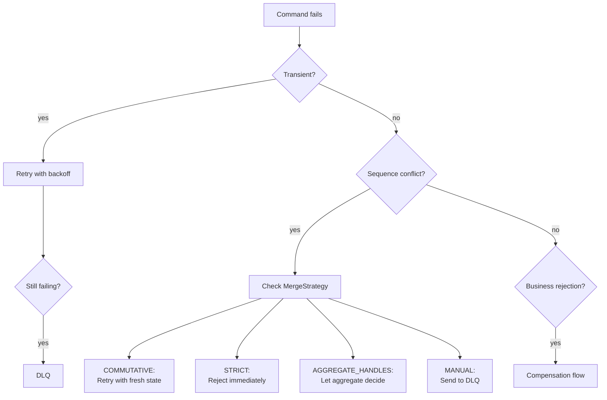

import { Tabs, TabItem } from '@astrojs/starlight/components';


Angzarr provides layered error recovery: automatic retry for transient failures, dead letter queues for persistent failures, and compensation flows for saga rejections.

---

## Overview



---

## Errors Are Keys, Never English

Every error angzarr sends carries a **key** and an **argument map**, never rendered text (decision 14.37). Text is rendered only where it is displayed (a console, a UI, a client's `message()`), from a [Fluent](https://projectfluent.org/) catalog keyed by the code. A log shows the code and its args as they are.

| Where | The key | The map |
|-------|---------|---------|
| A gRPC status | The status message, and the `google.rpc.ErrorInfo` reason (domain `angzarr.io`) | The `ErrorInfo` metadata |
| A message (`RefusalResponse`, `ProjectorFailure`, `AngzarrDeadLetter`, the DLQ details) | `Diagnostic.code` | `Diagnostic.args` |
| A typed refusal object | Its type (on the wire, reason `COMMAND_REFUSED` with metadata `refusal_type`) | Its fields |

This holds for business code too. A handler's typed refusal is its refusal object; any other rejection, and every handler bug, carries a diagnostic code and its args. No free text crosses any boundary: a handler bug is answered `UNHANDLED_HANDLER_ERROR`, carrying the handler's own diagnostic as its cause (a panic's cause is `HANDLER_PANICKED`), and what the error or panic said stays in the handler's own log. A wrapped cause is flattened into the args: its code under the arg's name and its args under `<name>.<arg>`.

Every distinct condition has its own reason key, so no two conditions share a key and differ only by text. The framework's keys are the enums of `io/angzarr/v1/reasons.proto` (in the Proto API reference), one per component that answers them (`RouterReason`, `HostReason`, `CoordinatorReason`), each value's comment giving its status and args; on the wire a key is the value's bare name. Some of them:

| Condition | Reason | Status |
|-----------|--------|--------|
| A fold fails on a persisted event | `FOLD_FAILED` | `INTERNAL` |
| A fold fails on an event the command emitted | `FOLD_FAILED_EMITTED` | `INTERNAL` |
| A command type no handler claims, after the coordinator upcast it | `UNKNOWN_COMMAND_TYPE` (metadata `type_url` as sent, `upcast_type_url` as delivered; the router itself reports only `type_url`, the type it was given) | `INTERNAL` |
| A fact type no handler claims, after the coordinator upcast it | `NO_FACT_HANDLER` (metadata as for `UNKNOWN_COMMAND_TYPE`) | `INTERNAL` |
| A pass-through `CommandRefused` the source has no `on_refused_<Command>` for | `NO_REFUSAL_HANDLER` (metadata `command_type`) | `INTERNAL` |
| A dispatch to a kind the business process does not host | `NO_COMPONENT_OF_KIND` | `UNIMPLEMENTED` |
| A second component, built with or registered beside the one hosted | `DUPLICATE_COMPONENT` (metadata `component`, `component_kind`) | `INTERNAL` |
| A policy's translated refusal fact that is more than a payload (the coordinator's check) | One key per fault: `REFUSAL_FACT_ADDRESSED`, `REFUSAL_FACT_NO_PAGE`, `REFUSAL_FACT_NOT_A_FACT`, `REFUSAL_FACT_IDENTIFIED` | `INTERNAL` |
| Bytes that do not decode as the message expected | `ANY_DECODE_FAILED` (metadata `message_type`, and the decoder's own text as `ext_err_txt`) | `INTERNAL` |

---

## Retry with Backoff

Transient failures (network issues, temporary unavailability) are automatically retried with exponential backoff and jitter.

### Default Backoff Policies

| Context | Min Delay | Max Delay | Max Attempts | Jitter |
|---------|-----------|-----------|--------------|--------|
| Saga commands | 10ms | 2s | 10 | Yes |
| gRPC connections | 100ms | 5s | 30 | Yes |

### Retryable vs Non-Retryable Errors

| gRPC Code | Meaning | Retryable? | Action |
|-----------|---------|------------|--------|
| `FAILED_PRECONDITION` | Sequence mismatch (stale client state) | Yes | Fetch fresh state, rebuild command |
| `ABORTED` | Sent to DLQ (MERGE_MANUAL) | No | Manual intervention required |
| `INVALID_ARGUMENT` | Bad command data | No | Fix command, resubmit |
| `NOT_FOUND` | Aggregate doesn't exist | No | Check aggregate ID |
| `INTERNAL` | Server error | No | Check server logs |

### Retry Flow

```
1. Command fails with FAILED_PRECONDITION
2. Error details contain current EventBook
3. Client extracts EventBook from error
4. Client rebuilds state from fresh EventBook
5. Client re-evaluates business logic with fresh state
6. Client builds new command with correct sequence
7. Client resubmits
8. Repeat until success or max attempts
```

:::warning[Rebuild, Don't Just Re-sequence]
Simply updating the sequence number is insufficient. The command's payload may depend on state that changed. You must rebuild the command by re-running your business logic against the fresh state.
:::

<Tabs>
<TabItem label="Python">

```python
import grpc
from angzarr_client.proto import EventBook

def handle_sequence_error(error: grpc.RpcError) -> EventBook | None:
    """Extract fresh state from sequence mismatch error."""
    if error.code() == grpc.StatusCode.FAILED_PRECONDITION:
        details = error.trailing_metadata()
        for key, value in details:
            if key == "grpc-status-details-bin":
                return EventBook.FromString(value)
    return None

async def execute_with_retry(
    intent: CommandIntent,            # What the user wanted
    build_command: Callable,          # Function: (intent, state) -> CommandBook
    client: AggregateClient,
    max_attempts: int = 10,
) -> EventBook:
    """Execute command with retry, rebuilding from fresh state each attempt."""
    delay = 0.01
    current_state = None

    for attempt in range(max_attempts):
        # Get state if first attempt, otherwise use state from error
        if current_state is None:
            current_state = await client.get_state(intent.root_id)

        # Rebuild command from current state
        try:
            command = build_command(intent, current_state)
        except CommandRejectedError:
            raise  # Business logic rejected with fresh state

        try:
            return await client.execute(command)
        except grpc.RpcError as e:
            if e.code() == grpc.StatusCode.FAILED_PRECONDITION:
                # Extract fresh state for next attempt
                current_state = handle_sequence_error(e)
                await asyncio.sleep(delay)
                delay = min(delay * 2, 2.0)
            else:
                raise

    raise RuntimeError("Max retry attempts exceeded")
```

</TabItem>
</Tabs>

---

## Dead Letter Queue (DLQ)

Messages that cannot be processed after retries are routed to a dead letter queue for manual intervention.

### When Messages Go to DLQ

| Scenario | MergeStrategy | Result |
|----------|---------------|--------|
| Sequence mismatch | `MERGE_MANUAL` | Immediate DLQ |
| Event handler failed | Any | DLQ after retries |
| Payload retrieval failed | Any | DLQ |
| Max retries exceeded | `COMMUTATIVE` | DLQ |

### Topic Naming

DLQ topics are per-domain for isolation:

```
angzarr.dlq.{domain}
```

Examples:
- `angzarr.dlq.player` — Player domain failures
- `angzarr.dlq.hand` — Hand domain failures
- `angzarr.dlq.table` — Table domain failures

### Dead Letter Structure

```protobuf file=proto/io/angzarr/v1/types.proto region=dead_letter
```

### DLQ Backends

| Backend | Topic Format | Use Case |
|---------|--------------|----------|
| Channel | In-memory | Standalone mode, testing |
| AMQP | `angzarr.dlq` exchange | RabbitMQ production |
| Kafka | `angzarr-dlq-{domain}` | Kafka production |
| Pub/Sub | `angzarr-dlq-{domain}` | GCP production |
| SNS/SQS | `angzarr-dlq-{domain}` | AWS production |

### Configuration

```yaml
dlq:
  backend: amqp  # none | channel | amqp | kafka | pubsub | sns_sqs
  amqp_url: "amqp://localhost:5672"
  # OR
  kafka_brokers: "localhost:9092"
  # OR
  aws_region: "us-east-1"
  aws_endpoint_url: "http://localhost:4566"  # LocalStack
```

### Processing DLQ Messages

Dead letters require manual review. Common actions:

1. **Fix and replay** — Correct the issue, resubmit command
2. **Skip** — Mark as handled without replay (data not critical)
3. **Compensate** — Emit compensating events manually
4. **Escalate** — Route to operations team

---

## Saga Refusals

A target that refuses a saga's command (a business rejection, optionally with a typed refusal object) records nothing. The saga's coordinator calls `OnRefused`, and the saga builds one refusal fact for its own source domain: the standard `CommandRefused` passed through with the refusal object packed (the default), or a domestic fact its callback translates the refusal into (where the CLI selects translate at code generation). The fact's id is the refused command's id. The coordinator writes it to the outbox in the same transaction that clears the command's entry. The source records the fact and decides what it means.

| What happened | What happens |
|---------------|--------------|
| A business rejection | The refusal fact goes to the saga's source, retried, deduplicated by the refused command's id |
| A pass-through refusal the source has no handler for | The fact is refused `NO_REFUSAL_HANDLER`, dead-lettered for a human, and alerted; found only at run time, since nothing declares what a saga sends |
| The translating callback fails | The refusal is dead-lettered and alerted |
| A retryable failure | The command is retried |
| Any other terminal failure | The command is dead-lettered and alerted: a bug |
| A policy's command names no root, whatever its target | Refused `INTERNAL`, `POLICY_COMMAND_NO_ROOT` (with `domain` and `command_type`); dead-lettered and alerted, never delivered |
| A policy's command carries a correlation other than its trigger's | Refused `INTERNAL`, `POLICY_COMMAND_OTHER_CORRELATION`; dead-lettered and alerted, never delivered |

## Process Manager Failures

A process manager is a domain, so its failures are an aggregate's: a refused command records nothing and the sender gets the rejection; a failing fact handler is a bug (the fact is dead-lettered and alerted, a waiting sender answered `PARKED`). An input whose `correlation_id` differs from its root is delivered to that root (decision 14.36). Its start rule is its own:

| What happened | What the coordinator does | What the sender sees |
|---------------|---------------------------|----------------------|
| A non-starting fact for a correlation with no instance | Skips it; nothing is recorded, dead-lettered or alerted | `APPLIED` with no events |
| A non-starting command for a correlation with no instance | Refuses it, recording nothing | `FAILED_PRECONDITION`, `PM_NO_INSTANCE` |

---

## Saga Compensation

:::caution[Removed from the contract]
The compensation and notification path below is deleted from the current contract (backlog RM-2). A target that refuses records nothing; the saga delivers a refusal fact to its own source domain (see Saga Refusals, above). This section describes the prior implementation until the page is rewritten (backlog DOC-2).
:::

When a saga-issued command is rejected, angzarr notifies the original aggregate so it can emit compensation events.

### Compensation Flow

```
1. Saga emits command to target aggregate
2. Target aggregate rejects (business rule violation)
3. Coordinator records a RejectionNotification in its compensation outbox,
   then acknowledges the triggering event
4. Outbox delivers the Notification to the source aggregate
   (at least once; retried with backoff; dead-lettered on exhaustion)
5. Source aggregate emits compensation events
   OR
   Source aggregate returns RevocationResponse flags
```

### Notification vs Event

| Aspect | Notification | Event |
|--------|--------------|-------|
| In the event stream? | Never | Yes |
| Sequence? | No | Yes |
| Delivery | Coordinator outbox, at least once | Bus, from the stream |
| Purpose | Compensation | State change |

Notifications trigger behavior but aren't part of the event stream. Their delivery is durable: see [Delivery Guarantees](/features/compensation#delivery-guarantees).

### RejectionNotification

### Handling Rejections

The source aggregate registers rejection handlers using `@rejected` decorators. The framework dispatches based on the rejected command's domain and type — no if/else chains needed.

<Tabs>
<TabItem label="Python">

**[`examples/python/player/agg/rejected.py`](https://github.com/benjaminabbitt/angzarr/blob/main/examples/python/player/agg/rejected.py)**

```python file=vendor/examples/python/player/agg/rejected.py region=rejected_handler
```

</TabItem>
</Tabs>

### RevocationResponse Flags

When an aggregate cannot handle a rejection, it returns flags:

| Flag | Effect |
|------|--------|
| `emit_system_revocation` | Emit `SagaCompensationFailed` event to fallback domain |
| `send_to_dead_letter_queue` | Route to DLQ for manual review |
| `escalate` | Trigger webhook notification |
| `abort` | Stop saga chain, propagate error to caller |

### Configuration

```yaml
saga_compensation:
  fallback_domain: "system"                    # Domain for SagaCompensationFailed events
  fallback_emit_system_revocation: true        # Default when aggregate returns empty
  fallback_send_to_dlq: true
  fallback_escalate: false
  dead_letter_queue_url: "amqp://..."          # Optional DLQ URL
  escalation_webhook_url: "https://..."        # Optional webhook for alerts
```

---

## MergeStrategy and Conflicts

The `MergeStrategy` enum controls how sequence conflicts are handled:

| Strategy | Proto Value | Behavior on Conflict |
|----------|-------------|----------------------|
| `MERGE_COMMUTATIVE` | 0 (default) | `FAILED_PRECONDITION` — retryable with fresh state |
| `MERGE_STRICT` | 1 | `ABORTED` — immediate rejection, no retry |
| `MERGE_AGGREGATE_HANDLES` | 2 | Bypass validation — aggregate decides |
| `MERGE_MANUAL` | 3 | `ABORTED` + route to DLQ |

### When to Use Each

| Use Case | Strategy | Why |
|----------|----------|-----|
| Financial operations (balance checks) | `STRICT` | Must see current state |
| Counters, metrics | `COMMUTATIVE` | Order doesn't matter |
| CRDT-style operations | `AGGREGATE_HANDLES` | Aggregate merges conflicts |
| Auditable operations | `MANUAL` | Human review required |

### MERGE_MANUAL Flow

```
1. Command arrives with MERGE_MANUAL
2. Coordinator detects sequence mismatch
3. Command NOT executed
4. AngzarrDeadLetter created with SequenceMismatchDetails
5. Published to DLQ topic
6. Returns ABORTED status to caller
```

---

## Escalation

For critical failures, angzarr can trigger alerts via webhooks:

```yaml
saga_compensation:
  escalation_webhook_url: "https://ops.example.com/alerts"
```

Webhook payload:

```json
{
  "saga_name": "saga-table-player",
  "triggering_aggregate": {
    "domain": "table",
    "root": "550e8400-e29b-41d4-a716-446655440000"
  },
  "triggering_sequence": 5,
  "reason": { "code": "INSUFFICIENT_FUNDS", "args": { "available": "120", "requested": "500" } },
  "compensation_reason": { "code": "COMPENSATION_EMPTY_RESPONSE" },
  "occurred_at": "2024-01-15T10:30:00Z"
}
```

---

## Best Practices

### 1. Design for Idempotency

Handlers may be retried. Ensure repeated execution produces the same result.

```python
# BAD: Not idempotent
def apply_funds_deposited(state, event):
    state.balance += event.amount  # Adds again on retry!

# GOOD: Idempotent (events have absolute values)
def apply_funds_deposited(state, event):
    state.balance = event.new_balance  # Same result on retry
```

### 2. Use Appropriate MergeStrategy

```python
# Financial operations: STRICT
@merge_strategy(MergeStrategy.STRICT)
def handle_transfer(state, cmd):
    if cmd.amount > state.available:
        raise CommandRejectedError("INSUFFICIENT_FUNDS")

# Counters: COMMUTATIVE
@merge_strategy(MergeStrategy.COMMUTATIVE)
def handle_increment(state, cmd):
    return ValueIncremented(delta=cmd.delta)

# Audit-critical: MANUAL
@merge_strategy(MergeStrategy.MANUAL)
def handle_compliance_action(state, cmd):
    return ComplianceActionTaken(action=cmd.action)
```

### 3. Handle Notifications Explicitly

Don't ignore `RejectionNotification` — either compensate or escalate:

```python
def handle_rejection(state, rejection):
    if can_compensate(rejection):
        return build_compensation_event(rejection)
    else:
        return RevocationResponse(
            send_to_dead_letter_queue=True,
            escalate=True,
            reason="CANNOT_COMPENSATE",
        )
```

### 4. Monitor DLQ Depth

Set up alerts for DLQ message accumulation:

```yaml
# Prometheus alert
- alert: DLQBacklog
  expr: dlq_messages_total > 100
  for: 5m
  labels:
    severity: warning
```

---

## Next Steps

- **[Patterns Reference](/reference/patterns)** — MergeStrategy, SyncMode details
- **[Sagas](/components/saga)** — Cross-domain coordination
- **[Payload Offloading](/operations/payload-offloading)** — Large message handling
